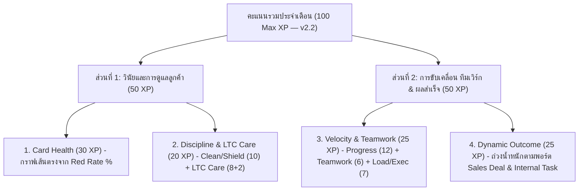

# 08. ระบบนับเวลา การ์ดแดง และเกณฑ์การให้คะแนน Leaderboard (Pipeline Due Date, Zero-Button AI Auto-Grader & 100 XP Scoring Specification — v2.2)

> **กลุ่มเป้าหมายผู้อ่าน**: ผู้บริหาร, หัวหน้าแผนก (Management), พนักงานทุกแผนก, ผู้ดูแลระบบ (Admin) และ AI Agent  
> **วัตถุประสงค์**: กำหนดมาตรฐานกลางสำหรับกติกานาฬิกาเวลาทำงาน (`08:00–17:00`), วันหยุดสั้น/วันหยุดยาว, ระบบ Due Date (`45 วัน` มาตรฐาน / `180 วัน` งานระยะยาว), ระบบ **Zero-Button AI Auto-Grader 4 เกรด (`+0h / +9h / +27h Outreach / +27h Progress ★`)**, ระบบจัดเก็บไฟล์ภาพ WebP + Google Drive Cold Storage และสูตรคำนวณคะแนน **100 Max XP รุ่น v2.2 (`30 + 20 + 25 + 25`)** ที่ส่งเสริมความคืบหน้าทุกใบ การเสียสละช่วยทีม คนถือการ์ดเยอะ และการดูแลลูกค้าห่างหาย (`LTC`) อย่างเป็นรูปธรรม

---

## สถานะเอกสารและขอบเขตการใช้งาน (Implementation Status)

> [!IMPORTANT]
> เพื่อความชัดเจนทางวิศวกรรมและตรงตามโค้ดที่รันอยู่จริง เอกสารฉบับนี้แสดงสถานะปัจจุบัน (**Active v2.2 — Zero-Button AI Auto-Grading & Rebalanced 100 XP**) ดังนี้:
> 1. **ส่วนที่เปิดใช้งานจริงและผ่าน Automated Tests ครบถ้วนแล้ว (Implemented & Verified)**:
>    - กติกานาฬิกาเวลาทำงาน `Asia/Bangkok (08:00–17:00)` + พักเวลาอัตโนมัติในวันหยุดสั้น `1–2 วัน` + **Post-Holiday Check-In Cap** หลังวันหยุดยาวบริษัท `≥ 3 วัน` (`src/lib/business-days.ts`)
>    - ระบบ **Workday-Aligned 3-Stage Card Lifecycle** (ปกติ → `Yellow Card` เตือนล่วงหน้าเต็ม 1 วันทำงาน → ตัด `Red Card` ตอน **`08:00 น.` ของวันทำงานถัดไป** และคิดชั่วโมงแดงตามเวลาทำงานจริงจนกว่าจะเคลียร์), เพดาน Due Date มาตรฐาน **`45 วัน`** + เพดานงานระยะยาว **`180 วัน`** (เมื่อระบุเหตุผล `≥ 20 ตัวอักษร`), ระบบแยกแยะงานรายเดือนออกจาก `Postponed xN` (`analyzeDueDateTimeline`) พร้อม AI ตรวจสอบเหตุผล Due Date (`gradeDueDateReasonWithAi`)
>    - ระบบ **Zero-Button AI Auto-Grading 4 เกรด (`NOTE_0H`, `BRIEF_9H`, `OUTREACH_27H`, `PROGRESS_27H`)** โดยตัดปุ่มเลือก `+9h / +27h` แบบกดเองออกทั้งหมด ประเมินผลเบื้องต้น `< 1ms` (`src/lib/pipeline-update-quality.ts`) ควบคู่กับ **`gemini-2.5-flash` (`thinkingBudget: 0`)** เบื้องหลังแบบ `0ms` UI Latency (`gradeActivityCommentWithAi` ใน `src/lib/actions/ai-accelerator.ts`) พร้อมปิดช่องโหว่การแก้ข้อความย้อนหลัง (`editActivityLog`) และการปลอมแปลง Tag จากฝั่ง Client
>    - ระบบบีบอัดภาพฝั่งเบราว์เซอร์เป็น **WebP** อัตโนมัติ + **Cold Storage Archival (`Cloudinary → Google Drive`)** พร้อม Authenticated Proxy Route `/api/attachments/drive/[fileId]`
>    - สูตรคะแนน **Unified 100 Max XP (v2.2)** แบ่งสัดส่วน **`Card Health (30) + Discipline & LTC Care (20) + Velocity & Teamwork (25) + Dynamic Outcome (25)`** (`src/lib/dashboard/leaderboard-scoring.ts`, `leaderboard-daily-sampling.ts`, `leaderboard-data.ts`)
> 2. **แผนขยายผลเชิงโครงสร้างฐานข้อมูลระยะถัดไป (Future Scaling Option — Planned)**:
>    - การสร้างตาราง `DailyCardHealthSnapshot` ในฐานข้อมูลเพื่อ Materialize ผลตัดรอบ `23:00 น.` ของวันในอดีตลง Disk ถาวรเมื่อจำนวนการ์ดระดับหมื่นใบ (ปัจจุบันใช้ Pre-Indexed In-Memory Sampling ร่วมกับ Shared Department Memory Cache 60 วินาที และ Lightweight Winner Summary `< 200B` บน Navbar)

---

## 1. ภาพรวมปรัชญาการให้คะแนน 100 Max XP (v2.2 Rebalanced Portfolio)

ระบบคะแนน v2.2 ออกแบบมาเพื่อตอบโจทย์วัฒนธรรมการทำงานจริง 4 ประการพร้อมกัน:
1. **งานทุกใบมีความคืบหน้าจริง** (แยกการส่งข้อความติดตามทั่วไป `Outreach +27h` ออกจากความคืบหน้าเดินหน้างาน `Progress +27h ★` โดยไม่บีบให้พนักงานทักกวนลูกค้าทุกวัน)
2. **พนักงานที่ถือการ์ดเยอะทำงานหนักได้รับความคุ้มครองและแต้มความทุ่มเท** (`Heavy-Load Shield` เมื่อถือ `≥ 10` ใบ + `Workload Dedication 3 XP` + ยกเว้นการ์ดรอผลิต/รอโหลดตู้จากตัวหาร Coverage)
3. **ส่งเสริมความเสียสละช่วยงานเพื่อนร่วมทีม** (`Selfless Teamwork 6 XP` + `Pure Collaborator Health` + แต้มช่วยปิดดีลใน `Outcome`)
4. **ปลุกการดูแลลูกค้าเก่า `LTC` รายบุคคลอย่างแท้จริง** (`Individual 2-Step LTC Care 8 XP` + `Team Zero-LTC 2 XP`)

---

## 2. กติกานาฬิกาเวลาทำงาน วันหยุด และระบบ Due Date

### 2.1 เวลาทำการปกติและวันหยุดระยะสั้น (`1–2 วัน`)
- **เขตเวลามาตรฐาน**: `Asia/Bangkok (UTC+7)` เท่านั้น ทั้งฝั่ง Server และ Browser
- **เวลาทำการ**: วันจันทร์ – วันเสาร์ `08:00 – 17:00 น.` (คิดเป็น **9 ชั่วโมงทำงาน / วัน**)
- **ช่วงเวลาหยุดพักอัตโนมัติ (100% Auto-Pause)**: นอกเวลาทำการ (`17:00 – 08:00 น.`), วันอาทิตย์ (`Sunday`), วันหยุดบริษัท (`Company Dayoff`), และวันลาส่วนบุคคล (`User Leave`)

### 2.2 กฎเพดานเช็กอินวันแรกหลังวันหยุดยาวบริษัท (`Post-Holiday Check-In Cap` สำหรับหยุดยาว `≥ 3 วัน`)
- เมื่อปฏิทินบริษัทมีวันหยุดต่อเนื่องกันตั้งแต่ **`3 วันปฏิทินขึ้นไป`** การ์ด `OPEN` ที่ไม่ได้ตั้ง `Due Date` นัดหมายหลังวันหยุดไว้จะขึ้นเป็น **`Yellow Card` (`Check-in`) ตลอดวันทำงานวันแรกที่เปิดงาน** และจะตัดเป็น `Red Card` เวลา **`08:00 น.` ของวันทำงานถัดไป** เพื่อให้ติดตามงานได้ตลอดวันเปิดงานโดยการ์ดไม่แดงตั้งแต่เช้าหรือเย็น

### 2.3 กติกาการ์ด 3 ระยะ (`Normal → Yellow Card ทั้งวัน → Red Card 08:00 น. วันทำงานถัดไป`) และเพดาน `45 วัน` / `180 วัน`
1. **วันสร้าง/อัปเดตการ์ดนับเป็น Day 0 เสมอ**: ไม่ว่าอัปเดตตอน `09:30` หรือ `16:50` ระบบนับวันทำงานถัดไปเป็น Day 1 (`+9h` = เหลืองในวันทำงานที่ 1 ทั้งวัน → แดง `08:00` วันทำงานที่ 2; `+27h` = ปกติ 2 วันทำงาน → เหลืองในวันทำงานที่ 3 ทั้งวัน → แดง `08:00` วันทำงานที่ 4)
2. **ระยะสีเหลือง `Yellow Card` (`Due Today` / `Clear Today` ตลอดวันทำงานจนถึง `07:59:59` ของวันทำงานถัดไป)**: แสดงขอบสีเหลืองทองและป้ายเตือน ยังไม่นับชั่วโมงการ์ดแดง (`0 ชม.`) หากเกิดตรงวันหยุด/วันลาของเจ้าของ ระบบเลื่อนวันสีเหลืองไปยังวันทำงานวันแรกที่กลับมาอัตโนมัติ
3. **ระยะสีแดง `Red Card` (ตั้งแต่ `08:00 น.` ของวันทำงานถัดไปเป็นต้นไป)**: เริ่มนับเป็นวันที่มีการ์ดแดงทันที และสะสมชั่วโมงสีแดงตามเวลาทำงานจริง (`08:00–17:00`) จนถึงนาทีที่เข้ามาอัปเดตเคลียร์ (เคลียร์ `08:30` เสีย `0.5 ชม.` — เคลียร์ดึกหลัง `17:00` ไม่ล้าง `9.0 ชม.` ที่แดงมาทั้งวัน)
3. **เพดานการตั้ง Due Date**: มาตรฐานสูงสุด **`45 วัน`** และขยายได้ถึง **`180 วัน`** เมื่อพิมพ์อธิบายเหตุผลชัดเจน **`≥ 20 ตัวอักษร`** (รองรับงานจด Trademark, จองบูธข้ามไตรมาส, ออเดอร์ทยอยส่งหลายตู้)
4. **AI ตรวจสอบเหตุผล Due Date (`gradeDueDateReasonWithAi`)**: Server ล้าง Tag ปลอมแปลงจาก Client เสมอ และหากตั้ง Due Date พร้อมระบุสรุปความคืบหน้ายาว `≥ 22 ตัวอักษร` AI เบื้องหลังจะจำแนกเป็น `[PROGRESS_VERIFIED]` (นับแต้มความคืบหน้าจริง), `[OUTREACH_ONLY]` หรือ `[STALLING_ONLY]` อย่างแม่นยำ

---

## 3. ระบบ Zero-Button AI Auto-Grader 4 เกรด (ไร้ปุ่มกด `+9h` / `+27h`)

### 3.1 กฎเหล็กการไม่ลดเวลาเดิม (`Non-Punitive Ceiling Rule`)
$$\text{เวลาคงเหลือใหม่} = \max(\text{เวลาคงเหลือเดิม ณ ตอนนั้น},\ \text{โควตาเวลาที่ได้จากอัปเดตครั้งนี้})$$
- การ์ดที่เหลือเวลา `22 ชม.` หากโพสต์อัปเดตระดับ `+0h` หรือ `+9h` เวลาจะยังคงเหลือ **`22 ชม.` เท่าเดิม** (ไม่หดสั้นลง) และหากได้ระดับ `+27h` จะรีเซ็ตเป็น **`27 ชม.` เต็มใหม่** ทันที

### 3.2 ตารางจำแนกอัตโนมัติ 4 เกรด (`Heuristic < 1ms` + `Gemini 2.5 Flash Background Classifier`)

พนักงานพิมพ์สิ่งที่เป็นข้อเท็จจริงลงในช่องแชทและกดส่งได้ทันทีโดยไม่ต้องกดปุ่มเลือกเกรด:

| เกรดอัตโนมัติ | Tag ในระบบ | เกณฑ์การคัดแยกของระบบ & AI (เทียบประวัติ 10 ข้อความล่าสุด) | ผลต่อเวลาการ์ด | นับแต้ม Progress? |
| :--- | :---: | :--- | :---: | :---: |
| **1. `Note +0h`** | `[TIER:0H]` | • สั้นกว่า `< 12` ตัวอักษรจริง หรือตอบกลับย่อยใน `Reply` • แนบรูป/ไฟล์อย่างเดียวโดยไม่พิมพ์ข้อความสรุป • คำกลวงล้วน เช่น *"ติดตามลูกค้า"*, *"ทักคุณฝนอีกครั้ง"*, *"ยังไม่มีการ Update ค่ะ"* • Copy-Paste ซ้ำ `≥ 92%` ใน `10` ข้อความล่าสุดช่วง `14 วัน` โดยไม่มีข้อเท็จจริงใหม่ | **`+0 ชม.`** *(ไม่ล้าง Due Date)* | `0 XP` |
| **2. `Follow-up +9h`** | `[TIER:9H]` | • โทรไปไม่รับสาย / สายไม่ว่าง / ติดประชุมยังไม่ได้คุย และไม่ได้ส่งข้อความติดตามทิ้งไว้ • รายงานสั้นๆ ว่าทักไปแล้วแต่ไม่มีข้อความจริงที่ส่งหรือคำตอบที่ได้รับ | **`+9 ชม.`** *(1 วันทำงาน — ให้ตามซ้ำพรุ่งนี้)* | `0 XP` |
| **3. `Outreach +27h`** | `[TIER:27H:OUTREACH]` | • **ส่งข้อความติดตามงานที่มีเนื้อหาคำพูดจริงถึงลูกค้า** แม้ลูกค้า B2B ยังเงียบไม่ตอบ (เช่น *"09:01 Light สวัสดีครับคุณฝน เป็นอย่างไรบ้างครับ มีได้ลองใช้สินค้าของแคร์บิวดูบ้างมั้ยครับ"*) หรือแนบภาพแชทพร้อมสรุป • ติดต่อลูกค้าสำเร็จ ทราบสาเหตุที่ติดขัดชัดเจน แต่งานยังไม่ขยับขั้น (เช่น *"คุณฝนแจ้งว่าของตัวอย่างเพิ่งขึ้นตู้ไปต้นเดือน July"*) | **`+27 ชม.` เต็ม!** *(3 วันทำงาน — ไม่บีบทักกวนลูกค้าทุกวัน)* | `0 Progress` *(แต่ได้แต้ม LTC Step 1 & ช่วยทีม)* |
| **4. `Progress +27h ★`** | `[TIER:27H:PROGRESS]` | • **งานเดินหน้าไปอีกขั้นจริง!** เช่น ได้นัดหมายใหม่พร้อมวันเวลา, ลูกค้าอนุมัติสเปก/สูตร/อาร์ตเวิร์ก, ส่งใบเสนอราคา/ตัวอย่าง/PI/Invoice สำเร็จ, ได้รับ PO/ยอดโอน, หรือทำขั้นตอนของ `Internal Task` เสร็จสมบูรณ์ | **`+27 ชม.` เต็ม!** *(3 วันทำงาน)* | **ได้แต้ม `Real Card Progress` ★!** |

### 3.3 ประมาณการต้นทุน Token จริงของ `gemini-2.5-flash`
- เรียกเฉพาะข้อความที่ผ่านด่านแรก (`≥ 12` ตัวอักษรและไม่ใช่คำกลวง/ซ้ำ) โดยตั้งค่า `thinkingBudget: 0` และส่งเฉพาะ 5 ข้อความก่อนหน้าแบบย่อ (`~500 input tokens` + `~35 output tokens` ต่อครั้ง)
- ที่ปริมาณงานจริง `80–150` อัปเดต/วัน ใช้เพียง **`~45,000 – 85,000 tokens/วัน`** คิดเป็นต้นทุนเพียง **`~0.50 – 1.20 บาท/วัน` (`~15–30 บาท/เดือน`)** และทำงานเบื้องหลังผ่าน `runBackgroundJob` (`0ms` หน่วงหน้าจอ) พร้อมป้องกันการแก้ข้อความย้อนหลังใน `editActivityLog`

---

## 4. สถาปัตยกรรมจัดเก็บไฟล์ประหยัดพื้นที่ฟรีถาวร (Client WebP + Google Drive Cold Storage)
1. **บีบอัดภาพฝั่งเบราว์เซอร์เป็น `WebP` อัตโนมัติ (`ActivityFeedTab.tsx`)**: รองรับทั้งลากวางไฟล์และกด `Ctrl+V` วางภาพหน้าจอ ย่อขนาดไม่เกิน `1600px` (`quality: 0.82`) ลดขนาดภาพแคปหน้าจอจาก `~980 KB` เหลือ `~120–180 KB`
2. **Cold Storage Archiver (`/api/cron/archive`)**: ย้ายไฟล์แนบของการ์ดที่ปิดเกิน `30 วัน` หรืออยู่ใน `LTC` เกิน `120 วัน` ไปยังโฟลเดอร์ `CRM_Archive` บน Google Drive และเสิร์ฟผ่าน `/api/attachments/drive/[fileId]` โดยภาพและ PDF ในแชทไม่เสียและไม่ติดสิทธิ์ Google Drive

---

## 5. สูตรการคำนวณคะแนน 100 XP ทั้ง 4 หมวด (v2.2 Rebalanced)

### หมวดที่ 1: Card Health — สุขภาพการ์ดไม่ดองงาน (`เต็ม 30 XP`)
วัดจากอัตราส่วนชั่วโมงการ์ดแดงสะสมทั้งเดือน (`Red Rate %`) ของการ์ดที่ตนเป็น `Owner`:
- ช่วง `0% ≤ Red Rate ≤ 5%`: $\text{CardHealthXP} = 30 - (1.6 \times \text{RedRate})$ *(ได้ `30.0 XP` ที่ `0%`, `26.0 XP` ที่ `2.5%`, และ `22.0 XP` ที่เป้าหมาย `5.0%`)*
- ช่วง `5% < Red Rate < 15%`: $\text{CardHealthXP} = 22 - 2.2 \times (\text{RedRate} - 5)$ *(ได้ `11.0 XP` ที่ `10.0%`)*
- ช่วง `Red Rate ≥ 15%`: ได้ `0 XP`
- **Pure Collaborator Health (`เพดาน 85% = สูงสุด 25.5 XP`)**: สำหรับผู้ช่วยทีมที่ไม่ได้ถือการ์ดของตัวเองเลย (`0 Owned Cards`) แต่เข้าไปช่วยอัปเดต `+27h` ในการ์ดเพื่อนอย่างน้อย `≥ 3 ใบ` ระบบให้คะแนนสุขภาพการ์ดเต็มเพดานผู้ช่วย (`25.5 XP`) โดยไม่นำการปล่อยแดงภายหลังของเจ้าของตัวจริงมาหักคะแนนผู้ช่วย

---

### หมวดที่ 2: Discipline & LTC Care — วินัยรายวันและการดูแลลูกค้าห่างหาย (`เต็ม 20 XP`)
1. **Clean Workdays & Heavy-Load Shield (`เต็ม 10 XP`)**:
   - **วันบอร์ดสะอาด (`0 Red Cards` ตลอดวันทำงาน)**: รับ **`+0.5 XP / วันทำงาน`**
   - **เกราะคุ้มครองคนถือการ์ดเยอะ (`Heavy-Load Shield`)**: หากถือการ์ดที่เปิดอยู่ **`≥ 10 ใบ`** แล้วพลาดหลุดการ์ดแดงเพียง **`1 ใบ`** ในวันนั้น ระบบไม่ตัดเป็น `0` แต่ให้ **`+0.25 XP`** ในวันนั้นเพื่อไม่ให้คนแบกงานหนักเสียเปรียบคนถือการ์ดน้อย
   - *(สำหรับแผนกที่ไม่ใช่ฝ่ายขาย หรือผู้ที่ถือเฉพาะการ์ดงานภายใน `0 Sales Deals` เพดาน Clean Days & Shield จะขยายเป็น `เต็ม 20 XP` คือ `+1.0 XP` ต่อวันสะอาด และ `+0.5 XP` ต่อวันเกราะคุ้มครอง)*
2. **Active LTC Care (`เต็ม 10 XP` สำหรับแผนกขาย = `8 XP รายบุคคล` + `2 XP คะแนนทีม`)**:
   - **Individual 2-Step LTC Care (`เต็ม 8 XP` — สูงสุด `+2.0 XP` ต่อการ์ด `LTC-*`, ครบ `4 ใบ` เต็มเพดาน)**:
     - **ขั้นที่ 1 (`+1.0 XP`)**: กดดึงลูกค้าจาก `LTC` มาสร้างการ์ด `LTC-*` และส่งข้อความทักติดตามจริงจนผ่านเกณฑ์ `+27h` (`Outreach` หรือ `Progress`)
     - **ขั้นที่ 2 (`+1.0 XP`)**: ดูแลต่อเนื่องจริงอย่างใดอย่างหนึ่ง ได้แก่ **(ก)** มี `Progress +27h ★` เกิดขึ้นจริง, **(ข)** ปิดการขาย `WON`, **(ค)** เปิดการ์ดดูแลต่อเนื่องไม่ติดแดงและตั้ง `Due Date` นัดติดตามรอบถัดไปไว้ชัดเจน, หรือ **(ง)** มีประวัติติดตามจริงอย่างน้อย `≥ 2 วันทำงาน` ก่อนกดปิด `LOST` *(ป้องกันการกดดึง LTC มาทักประโยคเดียวแล้วกดปิด Lost ทิ้งเพื่อปั๊มแต้ม!)*
   - **Team Zero-LTC Bonus (`เต็ม 2 XP`)**: รับทุกคนในแผนกวันละ **`+0.1 XP`** เมื่อเคลียร์คิวปุ่ม `LTC` จนเหลือ `0 ราย` ก่อน `17:00 น.`

---

### หมวดที่ 3: Velocity & Teamwork — ความคืบหน้างานทุกใบ ทีมเวิร์ก และความทุ่มเท (`เต็ม 25 XP`)

| หมวดย่อยของ Velocity (v2.2) | เพดานคะแนน | วิธีคำนวณจากหลักฐานการทำงานจริง |
| :--- | :---: | :--- |
| **1. Real Card Progress** *(ความคืบหน้าจริงของการ์ด)* | **เต็ม `12 XP`** *(`8` Volume + `4` Coverage)* | • **Progress Volume (`เต็ม 8 XP`)**: ได้ **`+1.0 XP`** ต่อการ์ดที่มีอัปเดตระดับ **`Progress +27h ★`** (และหากการ์ดใบเดิมขยับความคืบหน้าหลายระลอกห่างกัน `≥ 5 วัน` ได้โบนัสเพิ่มอีก `+0.5 XP/รอบ` สูงสุด `+2.0 XP` ต่อใบ) • **All-Card Coverage (`เต็ม 4 XP`)**: วัดสัดส่วนการ์ดที่มีความคืบหน้าเทียบกับการ์ดที่พร้อมขยับในมือ — **ทำคืบหน้าถึง `60%` ของพอร์ต รับเต็ม `4.0 XP`!** *(โดยยกเว้นการ์ดเพิ่งสร้าง `< 27 ชม.`, การ์ดที่กำหนด `Goods Ready / Loading Date` รอผลิต/รอลงตู้ในอนาคต, และการ์ดงานระยะยาวที่ตั้ง `Due Date` ข้ามเดือนออกจากตัวหารอัตโนมัติ)* |
| **2. Selfless Teamwork** *(ความเสียสละช่วยงานทีม)* | **เต็ม `6 XP`** | ได้ **`+1.5 XP`** ต่อการ์ดของเพื่อนร่วมทีมที่เราเข้าไปช่วยพิมพ์อัปเดตระดับ `+27h` หรือช่วยทำเช็กลิสต์ `To-Do` สำเร็จตั้งแต่ `2 ข้อขึ้นไป` (ช่วยเพื่อนครบ `4 ใบ` รับเต็ม `6.0 XP`) |
| **3. Workload & On-Time Execution** *(ความทุ่มเทถือการ์ด & ตรงเวลา)* | **เต็ม `7 XP`** *(`3` Load + `4` On-Time)* | • **Workload Dedication (`เต็ม 3 XP`)**: ให้แต้มความทุ่มเท **`+0.2 XP` ต่อการ์ดที่ดูแลและมีการทำงานจริง** (ถือการ์ดแอคทีฟ `15 ใบขึ้นไป` รับเต็ม `3.0 XP`) • **On-Time Execution (`เต็ม 4 XP`)**: ได้ **`+1.0 XP`** ต่อรายการเมื่อเคลียร์ `Due Date` ทันก่อน `17:00 น.` (นัดล่วงหน้า `≥ 12 ชม.`), ติ๊กเสร็จ `To-Do` (สูงสุด 2/การ์ด), หรือกดรับและตอบงานด่วน `[URGENT_ACK]` |

---

### หมวดที่ 4: Outcome — ผลสำเร็จปลายทางถ่วงน้ำหนักตามพอร์ตการ์ดจริง (`เต็ม 25 XP`)
คำนวณน้ำหนักพอร์ตอัตโนมัติจาก $U_{\text{sales}} = 1.5 \times \text{OwnedSalesDeals}$ และ $U_{\text{task}} = 1.0 \times \text{OwnedInternalTasks} + 0.5 \times \text{ActiveCollaboratorCards}$:
- **คะแนนฝั่งงานขาย ($O_{\text{sales}} \le 25$)**:
  - ปิดดีล `WON` ครบเงื่อนไข (`Value > 0` + `Loading Date` + `Invoice`): **`+5 คะแนน/ดีล`**
  - มูลค่ายอดขายรวม (`Revenue Impact` — **สูงสุด `10 คะแนน`**): ทุกยอดขาย **`฿100,000` ได้ `+1 คะแนน`** (`฿1,000,000 = เต็ม 10 คะแนน`) หรือคำนวณตามสัดส่วนยอดขายในแผนก (ใช้ค่าที่สูงกว่า)
- **คะแนนฝั่งงานภายใน & ผู้ช่วยดีล ($O_{\text{task}} \le 25$)**:
  - **On-Time SLA (`สูงสุด 15 คะแนน`)**: คำนวณจากสัดส่วนงาน `INTERNAL_TASK` ที่ปิดเสร็จทันเวลาก่อนติดแดง **รวมถึงการ์ดโปรเจกต์ระยะยาวที่ยังเปิดอยู่ (`OPEN`) ไม่ติดแดงและมีอัปเดตความคืบหน้า `Progress +27h ★` ในเดือนนั้น** (ทำให้เจ้าของโปรเจกต์ข้ามเดือนได้เต็ม `15/15` โดยไม่ต้องรีบกดปิดการ์ดหลอก!)
  - **Deliverables, Milestones & Won Assists (`สูงสุด 10 คะแนน`)**: งานภายในที่ปิดเสร็จสมบูรณ์ **`+2.5 คะแนน/ใบ`**, ดีลเพื่อนที่เข้าไปช่วยจนปิด `WON` **`+2.0 คะแนน/ดีล`**, และความคืบหน้า (`Progress +27h ★`) บนโปรเจกต์งานภายในระยะยาวที่เปิดอยู่ **`+1.0 คะแนน/ครั้ง`** (สูงสุด `3 คะแนน/ใบ`)
- **คะแนนสุทธิหมวด Outcome**:
  $$\text{Outcome XP} = \text{round\_1dp}\Big((w_{\text{sales}} \times O_{\text{sales}}) + (w_{\text{task}} \times O_{\text{task}})\Big) \quad (\text{สูงสุด } 25\text{ XP})$$

---

## 6. กฎตัดสินกรณีคะแนนเท่ากัน (Tie-Breaker)
1. ลำดับที่ 1: ผู้ที่มี **`Outcome XP`** สูงกว่า ชนะ
2. ลำดับที่ 2: ผู้ที่มี **`Red Rate %`** ทั้งเดือนต่ำกว่า ชนะ
3. ลำดับที่ 3: ผู้ที่มีจำนวนชั่วโมงการ์ดที่รับผิดชอบสะสม (`Total Card Hours`) มากกว่า ชนะ
