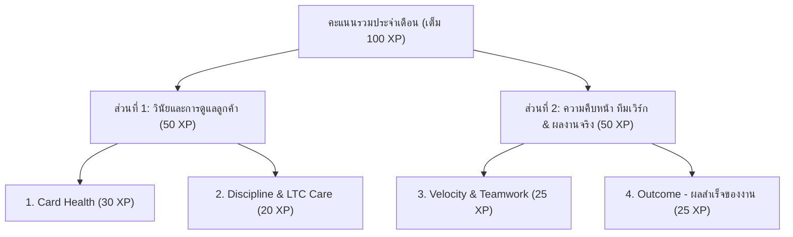

# คู่มือพนักงาน: กติกาการดูแลการ์ด ระบบ AI ประเมินเวลาอัตโนมัติ และคะแนน Leaderboard (100 XP — v2.2)

เอกสารฉบับนี้ออกแบบมาเพื่อให้เพื่อนร่วมงานทุกคน (ทั้งฝ่ายขาย, แอดมินประสานงาน, งานจดทะเบียน, และทุกแผนกที่ใช้บอร์ด Pipeline) อ่านเข้าใจกติกาใหม่ล่าสุดได้ทันทีภายใน 5 นาที — **ไม่ต้องกดปุ่มเลือก `+9h / +27h` อีกต่อไป พิมพ์ตามความจริงแล้วให้ AI จัดเกรดให้อัตโนมัติ** พร้อมเกณฑ์คะแนน **100 XP** ที่ยุติธรรมสำหรับคนทำงานจริง คนถือการ์ดเยอะ คนชอบช่วยทีม และคนขยันดูแลลูกค้าเก่า (`LTC`) ครับ

---

## 1. ภาพรวมคะแนนเต็ม 100 XP ใน 1 นาที (สัดส่วนใหม่ 30 / 20 / 25 / 25)

ทุกคนในบริษัทมีเพดานคะแนนสูงสุดเท่ากันที่ **100 XP ต่อเดือน** แบ่งออกเป็น **2 ส่วนใหญ่ (4 หมวดคะแนน)**:

| หมวดคะแนน                    | คะแนนเต็ม | วัดผลจากอะไร (เข้าใจง่ายๆ)                                                                                                                                                                                                                                                                                                                                                                                         |
| :--------------------------- | :-------: | :----------------------------------------------------------------------------------------------------------------------------------------------------------------------------------------------------------------------------------------------------------------------------------------------------------------------------------------------------------------------------------------------------------------- |
| **1. Card Health**           | **30 XP** | ดูแลการ์ดที่ตัวเองเป็นเจ้าของ (`Owner`) ไม่ให้ปล่อยค้างจนกลายเป็น **การ์ดแดง** (ยิ่ง `% การ์ดแดง` ต่ำ ยิ่งได้คะแนนเยอะ เป้าหมายบริษัทคือ **ไม่เกิน 5% = 22 XP** และถ้า `0% = 30 XP เต็ม!`)                                                                                                                                                                                                                         |
| **2. Discipline & LTC Care** | **20 XP** | **1) บอร์ดสะอาดรายวัน (`10 XP`):** วันละ `+0.5 XP` เมื่อ `0 การ์ดแดง` _(พิเศษ! คนถือการ์ด `≥ 10 ใบ` หากหลุดแดงแค่ `1 ใบ` มี **เกราะคุ้มครองได้ `+0.25 XP`**)_ **2) ดูแลลูกค้าห่างหาย `LTC` (`10 XP`):** ได้รายบุคคลใบละ **`+2 XP`** เมื่อดึง LTC มาทักและดูแลจริง (เต็ม `8 XP`) + โบนัสทีมเมื่อเคลียร์ปุ่ม LTC เหลือ 0 รายก่อนเลิกงาน (เต็ม `2 XP`) _(แผนกที่ไม่มีงานขายจะได้เพดานบอร์ดสะอาดเต็ม `20 XP` แทน)_  |
| **3. Velocity & Teamwork**   | **25 XP** | **1) ความคืบหน้างานจริง (`12 XP`):** ขยับงานระดับ `Progress +27h ★` (ปริมาณ `8 XP` + ดูแลทั่วถึงครบ `60%` ของพอร์ต `4 XP`) **2) เสียสละช่วยงานเพื่อน (`6 XP`):** ช่วยอัปเดต `+27h` หรือทำ `To-Do` ในการ์ดเพื่อน ได้ใบละ **`+1.5 XP`** **3) ความทุ่มเทถือการ์ด & ส่งงานตรงเวลา (`7 XP`):** แต้มคนถือการ์ดเยอะ (`+0.2 XP/ใบ` เต็ม `3 XP`) + เคลียร์ Due Date ทันเวลา / ติ๊ก `To-Do` / รับงานด่วน (เต็ม `4 XP`) |
| **4. Outcome**               | **25 XP** | **ผลสำเร็จปลายทางตามประเภทการ์ดที่ถือจริง:** การ์ดขายวัดจาก **ปิดดีล `WON` (`+5/ดีล`) + ยอดขาย (`฿100k = +1 แต้ม`)** / การ์ดงานภายใน (Admin & Project) วัดจาก **SLA ไม่ติดแดง (`15 XP`) + งานที่ปิดจบ/คืบหน้ารายเดือน/ช่วยเพื่อนปิดดีล (`10 XP`)**                                                                                                                                                                 |

---

## 2. นาฬิกาเวลาทำงาน การ์ดแดง & วันหยุด/วันลา

- **เวลาทำการที่นาฬิกาเดิน**: **วันจันทร์ – วันเสาร์ เวลา `08:00 – 17:00 น.`** (คิดเป็น **วันละ `9 ชั่วโมงทำงาน`**) นอกเวลา `17:00 – 08:00 น.` นาฬิกาหยุดเดิน 100%
- **การ์ดทั่วไปที่ไม่ได้ตั้ง Due Date**: มีเวลาเริ่มต้น **`3 วันทำงานเต็ม`** (ปกติ 2 วัน → วันทำงานที่ 3 ขึ้น **`Yellow Card`** เตือนทั้งวัน → เช้าวันทำงานที่ 4 เวลา **`08:00 น.`** จึงเปลี่ยนเป็น **`Red Card`** ไม่มีการตัดแดงตอนเย็นใกล้เลิกงาน!)
- **การนับคะแนนเมื่อขึ้น `Red Card` ตอน `08:00 น.`**: ทันทีที่ข้ามเป็น `Red Card` ตอน `08:00 น.` ระบบนับเป็นวันที่มีการ์ดแดงและคิดชั่วโมงแดงตามเวลาทำงานจริงจนกว่าจะอัปเดตเคลียร์ (เช่น เคลียร์ตอน `08:30 น.` เสียเพียง `0.5 ชม.` หากปล่อยถึงเย็นเสีย `9.0 ชม.`)

| ประเภทวันหยุด / วันลา                                                    | ระบบจัดการเวลาอย่างไร                                                                                                  | สิ่งที่พนักงานต้องทำ                                              |
| :----------------------------------------------------------------------- | :--------------------------------------------------------------------------------------------------------------------- | :---------------------------------------------------------------- |
| **1. วันหยุดสั้น `1–2 วัน` ติดกัน** _(วันอาทิตย์ หรือ เสาร์-อาทิตย์)_ | **พักนาฬิกา 100%** เปิดงานมาเวลาเหลือเท่าเดิมก่อนหยุดเป๊ะ                                                              | ทำงานต่อตามปกติในวันเปิดทำการ                                     |
| **2. วันหยุดยาวบริษัท `≥ 3 วัน`** _(สงกรานต์ หรือ ปีใหม่)_            | **การ์ดไม่ระเบิดแดงตอนเช้า `08:00 น.`** แต่การ์ดที่ไม่ตั้ง Due Date จะขึ้น **`Yellow Card` (`Check-in`) ตลอดทั้งวันแรกที่เปิดงาน** | **เข้ามาอัปเดตติดตามงานภายในวันแรกที่กลับมาทำงาน (ก่อน `08:00 น.` วันทำงานถัดไป)** |
| **3. วันลาส่วนตัว (`Leave`)** _(ลาป่วย / ลาพักร้อน ที่ลงในระบบ)_      | ขึ้นสถานะ **`Paused (Leave)`** พักนาฬิกา **100%** แม้ลาหลายวันก็ไม่ถูกหดเวลาและไม่ถูกหักคะแนน                          | แจ้งและบันทึกวันลาในระบบให้เรียบร้อย                              |

---

## 3. ระบบใหม่! พิมพ์แชทปกติ AI จัดเกรดเวลาให้อัตโนมัติ 4 ระดับ (ไม่ต้องกดปุ่มเลือก!)

เหนือช่องพิมพ์แชท **ไม่มีปุ่มกดเลือก `+9h / +27h` อีกต่อไป** คุณเพียงพิมพ์สิ่งที่ทำลงไปตามความจริง แถบ **`AI Auto-Grade`** เหนือช่องพิมพ์จะประเมินเบื้องต้นให้เห็นสดๆ และเมื่อกดส่ง **AI เบื้องหลังจะอ่านบริบทเทียบกับแชทก่อนหน้า** เพื่อจัดเป็น 4 ระดับอัตโนมัติ:

| เกรดที่ได้รับบนแชท                                     | เมื่อไหร่จะได้เกรดนี้                                                                                                                                                                                 |                        เวลาการ์ดที่ได้                        |                      ได้แต้มความคืบหน้า (`Progress`) ไหม?                       | ตัวอย่างจากงานจริง                                                                                                                                            |
| :----------------------------------------------------- | :---------------------------------------------------------------------------------------------------------------------------------------------------------------------------------------------------- | :-----------------------------------------------------------: | :-----------------------------------------------------------------------------: | :------------------------------------------------------------------------------------------------------------------------------------------------------------ |
| **1. `Note +0h`** _(ป้ายสีเทา)_                     | • พิมพ์สั้นกว่า `12` ตัวอักษร หรือกดตอบใน `Reply` • **แนบรูป/ไฟล์อย่างเดียวโดยไม่พิมพ์ข้อความสรุป** • พิมพ์คำกลวงสั้นๆ หรือก๊อปวางประโยคเดิมซ้ำ (`≥ 92%`)                                       |    **`+0 ชม.`** _(เวลาเหลือเท่าเดิม ไม่ล้าง Due Date)_     |                                    ❌ ไม่ได้                                    | ❌ `"ทักคุณฝนอีกครั้ง"` ❌ `"ยังไม่มีการ Update ค่ะ"` ❌ แปะรูปแชทเปล่าๆ ไม่พิมพ์สรุป                                                                   |
| **2. `Follow-up +9h`** _(ป้ายสีฟ้า)_                | • โทรไปแล้วลูกค้าไม่รับสาย / สายไม่ว่าง / ติดประชุมยังไม่ได้คุย และยังไม่ได้ส่งข้อความเนื้อหาติดตามทิ้งไว้                                                                                            | **`+9 ชม.`** _(ต่อเวลาให้ 1 วันทำงาน เพื่อโทรซ้ำพรุ่งนี้)_ |                                    ❌ ไม่ได้                                    | ✅ `"โทรหาคุณฝนเรื่องใบเสนอราคาแล้ว สายไม่ว่าง เดี๋ยวพรุ่งนี้เช้าโทรติดตามอีกครั้ง"`                                                                          |
| **3. `Outreach +27h`** _(ป้ายสีเขียวมรกต)_          | • **ส่งข้อความติดตามงานที่มีคำพูดจริงหาลูกค้า** (แม้ลูกค้าเงียบยังไม่ตอบ ก็ได้ `+27h` เต็ม ไม่บีบให้ต้องทักจี้กวนลูกค้าทุกวัน!) • คุยกับลูกค้าสำเร็จ รู้สาเหตุที่ติดขัดชัดเจน แต่งานยังไม่ขยับขั้น |           **`+27 ชม.` เต็ม!** _(3 วันทำงานเต็ม)_           | ➖ **ไม่นับเป็น Progress การ์ด** _(แต่ได้แต้มช่วยทีม & แต้ม LTC ขั้นที่ 1!)_ | ✅ `"09:01 Light สวัสดีครับคุณฝน เป็นอย่างไรบ้างครับ มีได้ลองใช้สินค้าของแคร์บิวดูบ้างมั้ยครับ"` ✅ `"คุณฝนแจ้งว่าของตัวอย่างเพิ่งขึ้นตู้ไปต้นเดือน July"` |
| **4. `Progress +27h ★`** _(ป้ายสีเขียวมะนาวติดดาว)_ | • **งานเดินหน้าไปอีกขั้นจริง!** เช่น ได้นัดหมายวันเวลาใหม่, ลูกค้าคอนเฟิร์มสเปก/สูตร/แบบฉลาก, ส่งใบเสนอราคา/ตัวอย่าง/Invoice สำเร็จ, ได้รับ PO/ยอดโอน, หรือทำขั้นตอนงานภายในเสร็จ                     |           **`+27 ชม.` เต็ม!** _(3 วันทำงานเต็ม)_           |                    ⭐ **ได้แต้ม `Real Card Progress` เต็ม!**                    | ✅ `"ทีมงานติดต่อคุณฝนเพื่อนนำเสนอสินค้าใหม่ ลูกค้าตอบรับและนัดหมายเข้าพบวันศุกร์ เวลาบ่ายโมง"`                                                               |

> [!TIP]
> **กฎเหล็กไม่หดเวลาเดิม & ทริค `Ctrl+V` วางภาพไว:**
>
> - **อัปเดตถี่แค่ไหนเวลาก็ไม่หด!** หากการ์ดเหลือเวลา `22 ชม.` แล้วคุณพิมพ์ `Note +0h` หรือ `Follow-up +9h` เวลาการ์ดจะยังคงเหลือ **`22 ชม.` เท่าเดิม** (ใช้ค่าที่สูงกว่าเสมอ)
> - **กด `Ctrl+V` (หรือ `Cmd+V`) วางรูปแคปหน้าจอลงช่องแชทได้เลย!** เพียงพิมพ์สรุปสั้นๆ คู่กับรูปอย่างน้อย 1 บรรทัดเพื่อให้ระบบ AI อ่านเข้าใจบริบท รูปจะถูกบีบอัดเป็น WebP อัตโนมัติและเก็บถาวรใน Google Drive ไม่หายครับ

---

## 4. กติกาการตั้งและเลื่อน Due Date (`45 วัน` มาตรฐาน / `180 วัน` งานระยะยาว)

1. **ระบบเตือน `Yellow Card` เต็มวันในวันครบกำหนด**: ตลอดทั้งวันนัดหมาย (จนถึงก่อน `08:00 น.` ของวันทำงานถัดไป) การ์ดจะขึ้นขอบสีเหลืองทองและป้าย **`Due Today`** (ยังไม่แดงและยังไม่หักคะแนน) หากข้ามถึง **`08:00 น.` ของวันทำงานถัดไป** แล้วยังไม่มีอัปเดต `+9h` หรือ `+27h` จึงจะเปลี่ยนเป็น **`Red Card`** (และหากวันนัดตรงวันหยุด/วันลา ระบบเลื่อนวันสีเหลืองไปวันทำงานแรกที่กลับมาให้อัตโนมัติ)
2. **ตั้งล่วงหน้าได้สูงสุด `45 วัน` (งานทั่วไป) และถึง `180 วัน` (งานระยะยาว)**: งานจด Trademark, จองบูธข้ามปี, หรือออเดอร์ทยอยโหลดหลายตู้ ตั้งยาว `46–180 วัน` ได้ทันทีเพียงพิมพ์อธิบายเหตุผลในช่อง `Reason` ยาว **`≥ 20 ตัวอักษร`**
3. **อัปเดตครบในขั้นตอนเดียว**: หากพิมพ์สรุปผลความคืบหน้าจริงยาวๆ ลงในช่อง `Reason` ตอนตั้ง Due Date AI จะตรวจและให้แต้มความคืบหน้า **`Progress +27h ★`** อัตโนมัติโดยไม่ต้องพิมพ์ซ้ำในแชท!

---

## 5. เจาะลึกวิธีเก็บคะแนนทั้ง 4 หมวด (รวม 100 XP)

### หมวดที่ 1: `Card Health` (เต็ม `30 XP`)

คิดแบบเส้นตรงตาม `% ชั่วโมงการ์ดแดงสะสมทั้งเดือน` (ไม่กระโดดตกเหว):

- **`0.0%` การ์ดแดง** = **`30.0 XP` (เต็ม!)** | **`2.5%`** = **`26.0 XP`** | **`5.0%` (เป้าหมาย)** = **`22.0 XP`** | **`10.0%`** = **`11.0 XP`** | **`≥ 15.0%`** = **`0 XP`**

### หมวดที่ 2: `Discipline & LTC Care` (เต็ม `20 XP`)

1. **Clean Workdays & เกราะคนถือการ์ดเยอะ (`เต็ม 10 XP`)**:
   - วันทำงานที่มี `0 การ์ดแดง` ตลอดวัน รับวันละ **`+0.5 XP`**
   - **เกราะคุ้มครอง `Heavy-Load Shield`**: หากวันนั้นคุณถือการ์ดเปิดอยู่ **`ตั้งแต่ 10 ใบขึ้นไป`** แล้วเผลอหลุดแดงเพียง `1 ใบ` คุณยังได้รับ **`+0.25 XP`** (ไม่โดนตัดเหลือ 0!)
2. **การดูแลลูกค้าห่างหาย `LTC` (`เต็ม 10 XP` = รายบุคคล `8 XP` + ทีม `2 XP`)**:
   - **คะแนนรายบุคคล (`สูงสุด 8 XP` — ใบละ `+2.0 XP` เพียงดูแลจริงเดือนละ `4 ราย` ก็เต็มเพดาน!)**:
     - **ขั้นที่ 1 (`+1.0 XP`)**: กดดึงลูกค้าจากปุ่ม `LTC` มาเปิดการ์ดและส่งข้อความทักติดตามจริงจนได้ `+27h`
     - **ขั้นที่ 2 (`+1.0 XP`)**: ลูกค้าตอบกลับมีความคืบหน้า / ปิดการขาย `WON` / เปิดการ์ดดูแลต่อโดยตั้ง `Due Date` นัดรอบถัดไปไม่ปล่อยแดง / หรือติดตามจริงอย่างน้อย `2 วัน` ก่อนปิด `LOST` _(การดึงมาทักครั้งเดียวแล้วกดปิด Lost ทิ้งทันทีจะได้แค่ขั้นแรก ไม่ได้เต็ม 2 แต้ม)_
   - **โบนัสทีม (`สูงสุด 2 XP`)**: เคลียร์รายชื่อค้างในปุ่ม `LTC` จนเหลือ `0 ราย` ก่อน `17:00 น.` รับยกแผนกวันละ **`+0.1 XP`**

### หมวดที่ 3: `Velocity & Teamwork` (เต็ม `25 XP`)

1. **Real Card Progress (`เต็ม 12 XP` = ปริมาณ `8 XP` + ความทั่วถึง `4 XP`)**:
   - **ปริมาณงานที่เดินหน้า (`เต็ม 8 XP`)**: ได้ **`+1.0 XP`** ต่อการ์ดที่มีอัปเดตดาว **`Progress +27h ★`** (หากการ์ดเดิมขยับความคืบหน้าหลายรอบห่างกันเกิน 5 วัน ได้โบนัสเพิ่มอีก `+0.5 XP/รอบ`)
   - **ความใส่ใจครบทุกใบ (`Coverage เต็ม 4 XP`)**: ขยับการ์ดให้มีความคืบหน้าครบ **`60%` ของการ์ดที่พร้อมขยับในมือ** รับเต็ม **`4.0 XP`** _(การ์ดที่เพิ่งสร้างใหม่, การ์ดรอผลิต/รอวันโหลดตู้สินค้า, และการ์ดงานระยะยาวที่ตั้ง Due Date ข้ามเดือน จะไม่ถูกนำมาเป็นตัวหารให้คุณเสียเปรียบ!)_
2. **Selfless Teamwork (`เต็ม 6 XP`)**: เข้าไปช่วยอัปเดต `+27h` หรือช่วยทำ `To-Do` (2 ข้อขึ้นไป) ในการ์ดของเพื่อนร่วมทีม รับใบละ **`+1.5 XP`** (ช่วยเพื่อน `4 ใบ` รับเต็ม `6.0 XP`!)
3. **Workload Dedication (`3 XP`) + On-Time Execution (`4 XP`)**:
   - ถือการ์ดทำงานจริงได้รับแต้มความทุ่มเท **`+0.2 XP / ใบ`** (ถือ `15 ใบ` รับเต็ม `3.0 XP`)
   - เคลียร์ `Due Date` ทันก่อน `17:00 น.` / ติ๊กเสร็จ `To-Do` / กดรับงานด่วน `Urgent` รับรายการละ **`+1.0 XP`** (เต็ม `4.0 XP`)

### หมวดที่ 4: `Outcome` (เต็ม `25 XP`)

ปรับสัดส่วนอัตโนมัติตามพอร์ตการ์ดจริงที่คุณถือ:

- **ฝั่งการ์ดงานขาย (`Sales Deal` — เต็ม 25)**: ปิดดีล `Close as Won` ครบเงื่อนไข ได้ **`+5 คะแนน/ดีล`** + มูลค่ายอดขายรวมสูงสุด **`10 คะแนน`** (ทุก `฿100,000 = +1 คะแนน` หรือตามสัดส่วนยอดขายแผนก)
- **ฝั่งการ์ดงานภายใน & ผู้ช่วยทีม (`Internal Task & Assist` — เต็ม 25)**:
  - **On-Time SLA (`สูงสุด 15 คะแนน`)**: ปิดงานภายในทันเวลาก่อนการ์ดแดง _(รวมถึงโปรเจกต์ระยะยาวที่ยังเปิดอยู่แต่ดูแลไม่ให้แดงและมีความคืบหน้ารายเดือน ก็ได้เต็ม `15/15` ทันที!)_
  - **ผลงานสำเร็จ & ช่วยทีม (`สูงสุด 10 คะแนน`)**: ปิดงานภายในสำเร็จ **`+2.5/ใบ`**, ช่วยการ์ดขายเพื่อนจนปิด `WON` **`+2.0/ดีล`**, และอัปเดตความคืบหน้าโปรเจกต์ระยะยาว **`+1.0/ครั้ง`**

---

## 6. คำถามที่พบบ่อยจากเคสงานจริง (FAQ)

1. **ถาม: ถ้าทักไลน์ไปหาลูกค้าที่เงียบหายด้วยประโยคสุภาพยาวๆ แต่ลูกค้าไม่อ่านไม่ตอบ แบบนี้จะได้แค่ `+9h` จนต้องทักกวนลูกค้าทุกวันไหม?**
   - **ตอบ: ได้ `+27h` เต็ม (3 วันทำงาน) ครับ!** ระบบใหม่จะให้ป้าย **`Outreach +27h`** ทันทีเมื่อคุณส่งข้อความที่มีคำพูดติดตามจริง คุณจึงไม่ต้องทักจี้กวนลูกค้าทุกวัน ส่วนแต้มดาว **`Progress +27h ★`** จะเก็บไว้ให้เมื่อลูกค้าตอบกลับหรือมีงานเดินหน้าไปอีกขั้นครับ
2. **ถาม: คนที่รับผิดชอบการ์ดเยอะมาก (`15–25 ใบ`) จะเสียเปรียบคนถือการ์ดน้อย (`4 ใบ`) ไหม?**
   - **ตอบ: ไม่เสียเปรียบและได้รับแต้มชดเชยคุ้มค่าครับ!** คนถือการ์ดเยอะจะได้: **(1)** แต้มความทุ่มเท `Workload Dedication` สูงสุด **`+3.0 XP`** ฟรีทันที, **(2)** มี **`เกราะ Heavy-Load Shield`** ในหมวด Discipline หากเผลอหลุดแดง 1 ใบยังได้แต้มครึ่งหนึ่ง, และ **(3)** หมวด Coverage ตัดการ์ดรอผลิต/รอโหลดตู้/งานระยะยาวออกจากตัวหาร และคิดเต็มตั้งแต่ขยับครบเพียง `60%` ของที่เหลือครับ
3. **ถาม: เช็กคะแนนแยกหมวดของตัวเองและดูว่าต้องเก็บแต้มตรงไหนเพิ่มได้ที่ไหน?**
   - **ตอบ:** คลิกปุ่ม **รูปถ้วยรางวัล (`Leader`) มุมขวาบนของจอ** แล้วคลิกที่ชื่อตัวเอง ระบบจะเปิดหน้าต่างสรุปคะแนนทั้ง 4 หมวด (`30 / 20 / 25 / 25`) พร้อมปฏิทินสุขภาพการ์ดและ LTC รายวันให้ดูอย่างโปร่งใสตลอดเวลาครับ
