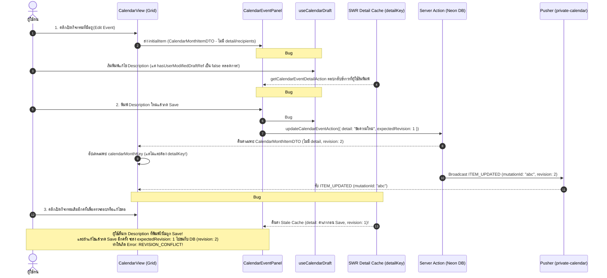
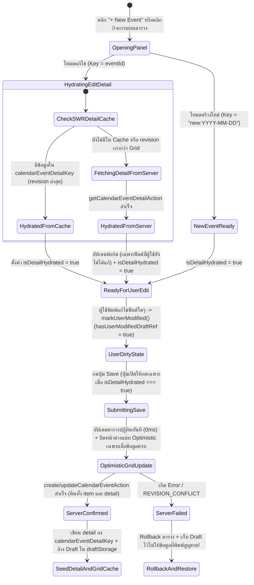
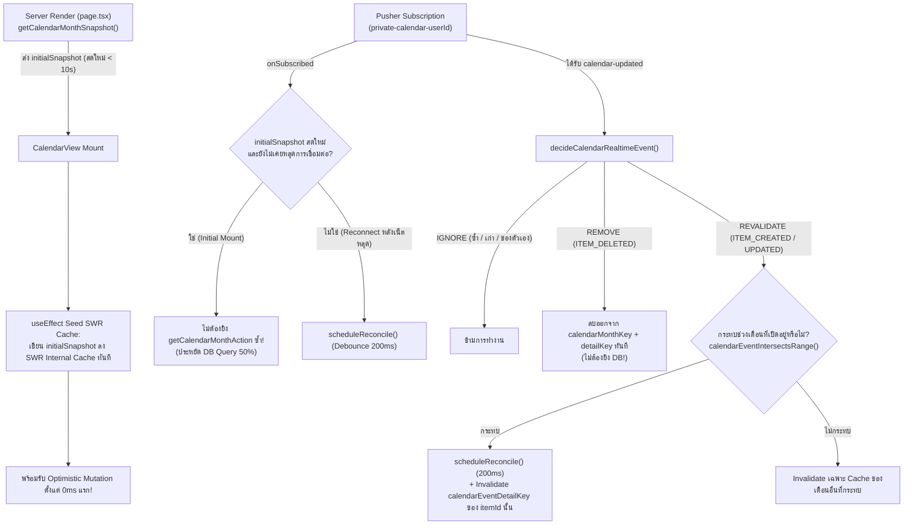

# แผนแม่บทสถาปัตยกรรม Real-Time และการบันทึกข้อมูลอย่างยั่งยืนสำหรับหน้า Calendar (`/calendar`)
**(Calendar Real-Time Architecture & Data Persistence Master Plan)**

> **สถานะเอกสาร:** Architectural Blueprint & Implementation Plan  
> **ขอบเขตระบบ:** `/calendar` (`src/app/calendar`, `src/components/calendar/*`, `src/lib/calendar/*`, `src/lib/actions/calendar.ts`, `src/lib/actions/holiday.ts`)  
> **เป้าหมายหลัก:**  
> 1. **แก้ไขปัญหาข้อมูลสูญหาย/ไม่ถูกบันทึก (Data Loss & Persistence Bugs)** ในหน้า **Edit Event / New Event** (เช่น `description` / `detail`, `recipients`, `repeatFrequency` หาย หรือเกิด `REVISION_CONFLICT` ซ้ำซ้อน) อย่างถอนรากถอนโคน  
> 2. **ยกระดับสถาปัตยกรรม Real-Time ของหน้า `/calendar`** ให้ทำงานแบบ **Hybrid Real-Time (Facebook-Style Tiered Sync)** ที่ตอบสนองทันที ($0\text{ms}$ Optimistic UI) บนทุก Action สำคัญ โดยไม่มีปัญหา SWR Cache ว่างตอนโหลดหน้าแรก และลดภาระการยิง Database ซ้ำซ้อนตอนเริ่มต้นหน้าลง 50%

---

## 1. บทสรุปผู้บริหาร (Executive Summary)

จากการตรวจสอบเชิงลึกในโครงสร้างโค้ดทั้งหมดของหน้า `http://localhost:3003/calendar` พบว่า:

1. **สาเหตุที่ผู้ใช้พบปัญหา Edit Event / New Event ไม่บันทึกข้อมูลบางอย่าง (เช่น `description` / `detail`)** ไม่ได้เกิดจาก Database หรือ Prisma ไม่บันทึกข้อมูลลงตาราง `CalendarEvent` เพียงอย่างเดียว แต่เกิดจาก **จุดบกพร่องเชิงสถาปัตยกรรม 5 จุดที่เชื่อมโยงกันระหว่าง SWR Detail Cache, Draft Store และ Lifecycle ของ `CalendarEventPanel`** ได้แก่:
   - **Root Cause #1 (Race Condition ตอนเปิดฟอร์มแก้ไข & Dead Code `hasUserModifiedDraftRef`):** เมื่อคลิกการ์ดกิจกรรมบนปฏิทิน ระบบส่ง `initialItem` (`CalendarMonthItemDTO` ซึ่งไม่มีฟิลด์ `detail`, `recipients`, `repeatFrequency`) เข้าไปใน `CalendarEventPanel` และตั้งค่า `isLoadingDetail = false` ทันที ทำให้ผู้ใช้เริ่มพิมพ์ `Description` ได้ก่อนที่ `getCalendarEventDetailAction` จะโหลดเสร็จ และเนื่องจากตัวแปร `hasUserModifiedDraftRef.current` ถูกประกาศเป็น `false` แต่**ไม่เคยถูกสั่งเป็น `true` เลยในโค้ด** ทันทีที่ API โหลดเสร็จ (`~200–500ms` ถัดมา) `useEffect` จึงเอาค่าเก่าจาก Server มาเขียนทับ (`updateDraft`) ลบสิ่งที่ผู้ใช้เพิ่งพิมพ์ทิ้งทันที หรือหากผู้ใช้กด Save เร็วเกินไป ระบบจะส่งค่าว่างจาก `initialFallbackDraft` (`detail: ""`, `recipients: []`) ไปทับข้อมูลจริงใน Database!
   - **Root Cause #2 (SWR `calendarEventDetailKey` Stale Cache หลังกด Save + Self-Mutation Ignore):** เมื่อกด Save สำเร็จ `updateCalendarEventAction` คืนค่ากลับมาเฉพาะ `CalendarMonthItemDTO` (ซึ่งไม่มี `detail` และ `recipients`) และโค้ดฝั่ง Client อัปเดตเฉพาะ Cache ของตารางรายเดือน (`calendarMonthKey`) **แต่ไม่เคยอัปเดตหรือ Invalidate SWR Cache ของ `calendarEventDetailKey(userId, eventId)` เลย!** ซ้ำร้ายเมื่อ Pusher ส่งสัญญาณ `ITEM_UPDATED` กลับมาที่เครื่องคนบันทึกเอง ฟังก์ชัน `decideCalendarRealtimeEvent` เห็นว่าเป็น `ownMutationIds` จึงคืนค่า `'IGNORE'` ทำให้ `detailRefreshToken` ไม่ทำงาน ส่งผลให้เมื่อผู้ใช้คลิกเปิดกิจกรรมเดิมขึ้นมาดูอีกครั้ง SWR จึงดึงข้อมูลเก่าก่อน Save (ที่ `detail` ยังว่างเปล่า และ `revision` เป็นเลขเก่า) มาแสดง และทำให้การกด Save ครั้งที่ 2 พังด้วย **`REVISION_CONFLICT`**!
   - **Root Cause #3 (สั่ง `clearCurrentDraft()` และ `onClose()` ก่อนที่ Server Action จะทำงานเสร็จ):** ใน `handleSubmit` สำหรับกิจกรรมทั่วไป (`isNonRecurring`) ระบบสั่งล้าง Draft และปิดหน้าต่างทันที**ก่อน** `await updateCalendarEventAction` / `await createCalendarEventAction` หากเกิดข้อผิดพลาดจาก Server หรือ Network ข้อมูล `Description` ที่ผู้ใช้พิมพ์ไว้ยาวๆ จะสูญหายทันทีโดยกู้คืนไม่ได้ และในจังหวะที่หน้าต่างกำลังเล่น Animation ปิด (`300ms`) `useEffect` อาจทำงานซ้ำและเขียนข้อมูลว่างทับลงใน `draftStorage`
   - **Root Cause #4 (ปัญหา `"new"` Draft Key ชนกันข้ามวัน):** การสร้างกิจกรรมใหม่ใช้คีย์ `"new"` ร่วมกันทั้งหมด ทำให้เมื่อคลิกวันที่ 10 แล้วปิดหน้าต่าง ไปคลิกวันที่ 25 เพื่อสร้างกิจกรรมใหม่ ระบบกลับดึงวันที่ 10 จาก `draftStorage` มาแสดงแทนวันที่ 25
   - **Root Cause #5 (การลากย้ายวัน `moveCalendarEventAction` / `moveCalendarDealDateAction` ไม่อัปเดต Detail/Popover Cache):** เมื่อลากย้ายการ์ดบนตารางปฏิทิน ระบบอัปเดตเฉพาะ `calendarMonthKey` แต่ไม่อัปเดต `calendarEventDetailKey` หรือ `calendarFinancialInfoKey` ทำให้เมื่อคลิกเปิดดูหลังลากย้าย ระบบแสดงวันที่เก่าและ `revision` เก่า

2. **ด้านสถาปัตยกรรม Real-Time ของหน้า `/calendar`:**
   - พบปัญหาเดียวกับหน้า `/pipeline` คือการใช้ `useSWR(currentKey, fetcher, { fallbackData: isInitial ? initialSnapshot : undefined, revalidateOnMount: !isInitial })` ซึ่งทำให้ **SWR Internal Cache ว่างเปล่า (`undefined`) ในช่วงแรกของการโหลดหน้า**
   - ที่ผ่านมาหน้า `/calendar` แก้ปัญหานี้ทางอ้อมด้วยการสั่ง `onSubscribed: () => scheduleReconcile()` ใน Pusher ซึ่ง**บังคับยิง API ดึงข้อมูลทั้งเดือนซ้ำอีกรอบทุกครั้งที่เปิดหน้าเว็บ** (ทำให้เสีย Database Query ซ้ำ 2 เท่าทุกครั้งที่เข้าหน้า `/calendar`) และในช่วงเสี้ยววินาทีก่อนที่ Pusher จะเชื่อมต่อเสร็จ การทำ Optimistic Update บน `mutate(currentKey, (current) => ...)` จะได้ `current === undefined` และไม่ทำงาน!

---

## 2. การวิเคราะห์เจาะลึกปัญหา Edit Event / New Event ข้อมูลไม่ถูก Save (5 Root Causes)



### รายละเอียดจุดบกพร่องทั้ง 5 จุดในโค้ดปัจจุบัน

#### 2.1 จุดที่ 1: Race Condition ระหว่าง `initialFallbackDraft` กับ `getCalendarEventDetailAction` และ Dead Code `hasUserModifiedDraftRef`
- **ไฟล์ที่เกี่ยวข้อง:** [`src/components/calendar/CalendarEventPanel.tsx`](file:///Users/light/my-crm/src/components/calendar/CalendarEventPanel.tsx#L70-L100) (บรรทัดที่ 70–100, 140–157, 187, 239–283)
- **กลไกที่ผิดพลาด:**
  1. ในบรรทัดที่ 92–94:
     ```ts
     const isInitialMatch = isEditMode && initialItem && initialItem.id === editingItemId;
     const [isLoadingDetail, setIsLoadingDetail] = useState(isEditMode && !isInitialMatch);
     ```
     เมื่อคลิกการ์ดกิจกรรมทั่วไป (Non-recurring) `initialItem.id === editingItemId` จะเป็น `true` ทำให้ `isLoadingDetail` เริ่มต้นเป็น `false` ทันที ทั้งๆ ที่ `initialItem` (`CalendarMonthItemDTO`) **ไม่มีฟิลด์ `detail`, `recipients`, `repeatFrequency`, `repeatUntil`**!
  2. ในบรรทัดที่ 187:
     ```ts
     const hasUserModifiedDraftRef = useRef(false);
     ```
     ตัวแปรนี้ถูกสร้างขึ้นมาเพื่อป้องกันไม่ให้ข้อมูลจาก API เขียนทับสิ่งที่ผู้ใช้พิมพ์ แต่ในโค้ดทั้งไฟล์ **ไม่มีบรรทัดไหนที่สั่ง `hasUserModifiedDraftRef.current = true` เลยแม้แต่จุดเดียว!**
  3. ส่งผลให้เกิดความเสียหาย 2 รูปแบบ:
     - **กรณีที่ 1 (API โหลดเสร็จทีหลัง):** ผู้ใช้เห็นฟอร์มพร้อมใช้งานจึงเริ่มพิมพ์ `Description` ทันที พอผ่านไป 300ms API `getCalendarEventDetailAction` โหลดเสร็จ `useEffect` ในบรรทัดที่ 255 เห็นว่า `!hasUserModifiedDraftRef.current` เป็น `true` จึงสั่ง `updateDraft({ ... detail: ev.detail || "" })` **ลบข้อความที่ผู้ใช้เพิ่งพิมพ์ทิ้งทันที**
     - **กรณีที่ 2 (ผู้ใช้กด Save เร็วก่อน API Detail โหลดเสร็จ):** เนื่องจากปุ่ม Save ไม่ได้ถูก Disable ระหว่างรอ `detailRes` หากผู้ใช้แก้ชื่อกิจกรรมหรือเวลาแล้วกด Save ทันที `handleSubmit` จะส่งค่าจาก `initialFallbackDraft` (`detail: ""`, `recipients: []`, `repeatFrequency: "NONE"`) ไปที่ Server **ทำให้ข้อมูล `Description`, ผู้รับ (`Recipients`) และการตั้งค่าทำซ้ำ (`Repeat`) เดิมในฐานข้อมูลถูกลบทิ้งทั้งหมด!**

#### 2.2 จุดที่ 2: SWR Cache ของ `calendarEventDetailKey` ไม่อัปเดตหลังกด Save และถูกข้ามโดย `ownMutationIds`
- **ไฟล์ที่เกี่ยวข้อง:** [`src/components/calendar/CalendarEventPanel.tsx`](file:///Users/light/my-crm/src/components/calendar/CalendarEventPanel.tsx#L214-L224) (บรรทัดที่ 214–224, 375–452) และ [`src/components/calendar/CalendarView.tsx`](file:///Users/light/my-crm/src/components/calendar/CalendarView.tsx#L413-L419) (บรรทัดที่ 413–419, 775–818)
- **กลไกที่ผิดพลาด:**
  1. `CalendarEventPanel` ใช้ `useSWR(detailKey, ..., { revalidateOnFocus: false, dedupingInterval: 30_000 })` โดย `detailKey` คือ `['calendar-event-detail', userId, eventId]`
  2. เมื่อกด Save ใน `handleSubmit`:
     - `updateCalendarEventAction` และ `createCalendarEventAction` คืนค่ากลับมาเฉพาะ `item: CalendarMonthItemDTO` (สำหรับแสดงบนตารางปฏิทิน) แต่ไม่ได้คืน `detail: CalendarEventDetailDTO`
     - `CalendarView.handleSaveSuccess` อัปเดตเฉพาะ `calendarMonthKey` แต่**ไม่ได้อัปเดตหรือ Invalidate `calendarEventDetailKey(userId, eventId)`**
     - เมื่อ Pusher ส่ง Event `ITEM_UPDATED` กลับมาที่ Browser ของผู้บันทึกเอง ฟังก์ชัน [`decideCalendarRealtimeEvent`](file:///Users/light/my-crm/src/lib/calendar/calendar-realtime.ts#L92) จะตรวจสอบ `if (event.mutationId && ownMutationIds.delete(event.mutationId)) return 'IGNORE';`
     - เมื่อได้ `'IGNORE'` บรรทัดที่ 418 ใน `CalendarView.tsx` (`setDetailRefreshToken((v) => v + 1)`) จึง**ไม่ถูกเรียกใช้งาน**!
  3. **ผลลัพธ์:** เมื่อผู้ใช้คลิกเปิดกิจกรรมนั้นขึ้นมาดูอีกครั้งหลังกด Save ระบบจะดึงข้อมูลเก่าจาก SWR Cache ของ `detailKey` มาใส่ลงใน `draft` ทำให้ผู้ใช้เห็นว่า **`Description` (`detail`) ที่เพิ่งพิมพ์และกด Save ไปหายไป (กลับเป็นค่าเก่า)** และค่า `revision` ในฟอร์มก็ยังคงเป็นเลขเก่า ทำให้การกด Save ครั้งต่อไปพังด้วย `REVISION_CONFLICT`!

#### 2.3 จุดที่ 3: การสั่ง `clearCurrentDraft()` และ `onClose()` ก่อนที่ Server จะยืนยันผลการบันทึก
- **ไฟล์ที่เกี่ยวข้อง:** [`src/components/calendar/CalendarEventPanel.tsx`](file:///Users/light/my-crm/src/components/calendar/CalendarEventPanel.tsx#L389-L393) (บรรทัดที่ 389–393)
- **กลไกที่ผิดพลาด:**
  1. โค้ดปัจจุบันสั่งล้าง Draft และปิดหน้าต่างทันทีตั้งแต่ยังไม่เริ่มรอ `await updateCalendarEventAction` / `await createCalendarEventAction`:
     ```ts
     if (isNonRecurring) {
       clearCurrentDraft();
       onClose();
     }
     ```
  2. หาก Server ตอบกลับว่าไม่สำเร็จ (เช่น `REVISION_CONFLICT`, `INVALID_TAG_SCOPE`, `INVALID_RECIPIENT_SCOPE` หรืออินเทอร์เน็ตสะดุด) หน้าต่างถูกปิดไปแล้ว และ `clearCurrentDraft()` ได้ลบข้อความ `Description` ที่ผู้ใช้พิมพ์ไว้ใน `draftStorage` ทิ้งไปเรียบร้อยแล้ว
  3. นอกจากนี้ ในจังหวะที่ `onClose()` ถูกเรียก หน้าต่างยังค้างอยู่ใน DOM อีก `300ms` เพื่อเล่น Exit Animation (`useCalendarPanelTransition`) การเรียก `clearCurrentDraft()` ขณะที่ Component ยัง Mount อยู่ทำให้ `draft` ถูกรีเซ็ตกลับเป็น `initialFallbackDraft` (`detail: ""`) และหาก `useEffect` ทำงานในช่วง 300ms นั้น จะทำให้เกิดการบันทึก Draft ที่ไม่สมบูรณ์ลงใน `draftStorage`

#### 2.4 จุดที่ 4: คีย์ `"new"` ใน `useCalendarDraft` ชนกันเมื่อคลิกต่างวันกันบนปฏิทิน
- **ไฟล์ที่เกี่ยวข้อง:** [`src/components/calendar/CalendarEventPanel.tsx`](file:///Users/light/my-crm/src/components/calendar/CalendarEventPanel.tsx#L138) และ [`src/lib/calendar/calendar-draft-store.ts`](file:///Users/light/my-crm/src/lib/calendar/calendar-draft-store.ts#L81-L125)
- **กลไกที่ผิดพลาด:**
  - เมื่อผู้ใช้คลิกช่องวันที่ 15 บนปฏิทินเพื่อเปิดหน้าต่าง New Event คีย์ใน `useCalendarDraft` คือ `"${userId}:new"`
  - หากผู้ใช้ปิดหน้าต่างไป แล้วคลิกช่องวันที่ 28 เพื่อสร้างกิจกรรมในวันที่ 28 คีย์ยังคงเป็น `"${userId}:new"` เหมือนเดิม ทำให้ `useCalendarDraft` ดึงค่า `startAt`/`endAt` ของวันที่ 15 จาก `draftStorage` มาแสดงแทนที่จะใช้วันที่ 28 ตามที่ผู้ใช้คลิก!

#### 2.5 จุดที่ 5: ความไม่สอดคล้องของ ID กิจกรรมที่ทำซ้ำ (Recurring Event Occurrence ID vs Base Event ID) และการลากย้ายการ์ด
- **ไฟล์ที่เกี่ยวข้อง:** [`src/components/calendar/CalendarView.tsx`](file:///Users/light/my-crm/src/components/calendar/CalendarView.tsx#L625-L645) (บรรทัดที่ 625–645, 709–759, 784–795) และ [`src/components/calendar/CalendarEventPanel.tsx`](file:///Users/light/my-crm/src/components/calendar/CalendarEventPanel.tsx#L92)
- **กลไกที่ผิดพลาด:**
  1. สำหรับกิจกรรมที่ทำซ้ำ (Recurring Event) การ์ดแต่ละใบบนตารางมี `item.id = "${eventId}:occ:${isoDate}"` ส่วน `item.sourceId = "${eventId}"`
  2. เมื่อเปิดแก้ไข `CalendarView` ตั้งค่า `editingItemId = item.sourceId` แต่ `initialItem.id` เป็น `"${eventId}:occ:..."` ทำให้ `initialItem.id === editingItemId` เป็น `false` เสมอ และ `initialFallbackDraft` ตั้งเวลาเริ่มต้นเป็นเวลาปัจจุบัน (`new Date()`) แทนเวลาของกิจกรรม!
  3. เมื่อลากย้ายการ์ดกิจกรรม (`moveCalendarEventAction`) หรือลากย้ายวันของ Deal (`moveCalendarDealDateAction`) ระบบอัปเดตเฉพาะ `calendarMonthKey` แต่**ไม่ได้อัปเดต `calendarEventDetailKey` หรือ `calendarFinancialInfoKey`** ทำให้เมื่อคลิกเปิดดูรายละเอียดหลังลากย้าย ฟอร์มจะแสดงวันที่เก่าและ `revision` เก่า

---

## 3. การวิเคราะห์ทุก Action & Notification ในหน้า `/calendar` และการจัดแบ่งระดับ Real-Time (3-Tier Hybrid Model)

เพื่อให้หน้า `/calendar` ทำงานได้ลื่นไหลระดับ Instant UI เหมือนแอปพลิเคชันสมัยใหม่ (เช่น Facebook / Google Calendar) โดยไม่สร้างภาระให้ Server และ Neon Database เกินความจำเป็น เราแบ่งการทำงานทั้งหมด **14 Actions/Flows** ออกเป็น **3 ระดับ (3 Tiers)** ดังนี้:

| ลำดับ | Action / Notification | ไฟล์หลักที่เกี่ยวข้อง | พฤติกรรมปัจจุบัน & ปัญหาที่พบ | ระดับ Real-Time ที่เหมาะสม (Target Tier) | แนวทางแก้ไขและยกระดับ |
| :--- | :--- | :--- | :--- | :--- | :--- |
| **1** | **สร้างกิจกรรมใหม่**<br/>(`createCalendarEventAction`) | [`CalendarEventPanel.tsx`](file:///Users/light/my-crm/src/components/calendar/CalendarEventPanel.tsx)<br/>[`calendar.ts`](file:///Users/light/my-crm/src/lib/actions/calendar.ts) | มี Optimistic Insert บนตาราง และส่ง Pusher `ITEM_CREATED` แต่ไม่ Seed `calendarEventDetailKey` และปิดหน้าต่างก่อน Server ตอบกลับ | **Tier 1:** Instant Optimistic ($0\text{ms}$) + Targeted Detail/Grid Cache Seed + Scoped Pusher | คืนค่าทั้ง `item` (`CalendarMonthItemDTO`) หรือ `items` (กรณีทำซ้ำ) **และ `detail` (`CalendarEventDetailDTO`)** เพื่อเขียนลง `calendarEventDetailKey` ทันที |
| **2** | **แก้ไขกิจกรรม**<br/>(`updateCalendarEventAction`) | [`CalendarEventPanel.tsx`](file:///Users/light/my-crm/src/components/calendar/CalendarEventPanel.tsx)<br/>[`CalendarView.tsx`](file:///Users/light/my-crm/src/components/calendar/CalendarView.tsx)<br/>[`calendar.ts`](file:///Users/light/my-crm/src/lib/actions/calendar.ts) | **พัง (Bug #1–#3):** `detail` (`description`) หายจาก Race Condition และ `calendarEventDetailKey` ไม่อัปเดตหลัง Save ทำให้เห็นค่าเก่าและติด `REVISION_CONFLICT` | **Tier 1:** Instant Optimistic ($0\text{ms}$) + Direct SWR Detail Cache Mutation + Scoped Pusher | แยกสถานะ `isHydratingDetail` ให้ชัดเจน, บันทึก `detail` (`CalendarEventDetailDTO`) จากผลลัพธ์ของ Server ลง `calendarEventDetailKey` โดยตรงทันที |
| **3** | **ลบกิจกรรม**<br/>(`deleteCalendarEventAction`) | [`CalendarEventPanel.tsx`](file:///Users/light/my-crm/src/components/calendar/CalendarEventPanel.tsx)<br/>[`CalendarView.tsx`](file:///Users/light/my-crm/src/components/calendar/CalendarView.tsx) | มี Optimistic Remove และส่ง Pusher `ITEM_DELETED` (ฝั่งผู้รับลบออกจาก Cache ทันทีโดยไม่ต้อง Query DB ซ้ำ) | **Tier 1:** Instant Optimistic Remove + Direct Pusher Remove | เพิ่มการล้าง `calendarEventDetailKey` และ `draftStorage` ของกิจกรรมที่ถูกลบทั้งฝั่งคนลบและฝั่งผู้รับผ่าน Pusher |
| **4** | **ลากย้ายวันกิจกรรมบนตาราง**<br/>(`moveCalendarEventAction`) | [`CalendarView.tsx`](file:///Users/light/my-crm/src/components/calendar/CalendarView.tsx)<br/>[`calendar.ts`](file:///Users/light/my-crm/src/lib/actions/calendar.ts) | อัปเดตตารางแบบ Optimistic ทันที แต่ไม่อัปเดต `calendarEventDetailKey` และถ้าทำตั้งแต่เปิดหน้าแรกๆ อาจเด้งกลับเพราะ SWR Cache ยังไม่ถูก Seed | **Tier 1:** Instant Optimistic Patch + Detail Cache Sync + Scoped Pusher | Seed SWR Cache ตั้งแต่ Mount แรก และเมื่อลากย้ายสำเร็จให้อัปเดต `startAt`, `endAt`, `revision` ใน `calendarEventDetailKey` ด้วย |
| **5** | **ลากย้ายวัน Deal บนตาราง**<br/>(`moveCalendarDealDateAction`) | [`CalendarView.tsx`](file:///Users/light/my-crm/src/components/calendar/CalendarView.tsx)<br/>[`calendar.ts`](file:///Users/light/my-crm/src/lib/actions/calendar.ts) | อัปเดตตารางทันที และส่ง Pusher ไปทั้งหน้า `/calendar` และ `/pipeline` แต่ไม่อัปเดต `calendarFinancialInfoKey` | **Tier 1:** Instant Optimistic Patch + Cross-View Cache Sync (`/calendar` + `/pipeline`) | อัปเดต `goodsReadyDate` / `goodsLoadingDate` และ `revision` ใน `calendarFinancialInfoKey` ทันทีหลังลากย้าย |
| **6** | **แก้ไขข้อมูล Sale Deal Popover**<br/>(`updateCalendarSaleDealAction`) | [`CalendarFinancialInfoPopover.tsx`](file:///Users/light/my-crm/src/components/calendar/CalendarFinancialInfoPopover.tsx)<br/>[`calendar.ts`](file:///Users/light/my-crm/src/lib/actions/calendar.ts) | `mutationId` ไม่ถูกส่งเข้า `ownMutationIds` ของ `CalendarView` ทำให้ยิง Refetch ซ้ำ และกรณีเพิ่ม/ลบวันที่ `goodsReadyDate` แถบสีบนปฏิทินไม่อัปเดตทันที | **Tier 1:** Instant Optimistic Patch + Shared `ownMutationIds` + Cross-View Sync | เชื่อม `onRegisterMutationId` กับ `CalendarView` และปรับปรุงการคำนวณแถบ `DEAL_GOODS_READY` / `DEAL_GOODS_LOADING` ให้รองรับทั้งการเพิ่ม/แก้ไข/ลบวันที่ |
| **7** | **เปิด/ปิด วันหยุดบริษัท (Public Holiday)**<br/>(`toggleCompanyHolidayAction`) | [`CalendarView.tsx`](file:///Users/light/my-crm/src/components/calendar/CalendarView.tsx)<br/>[`holiday.ts`](file:///Users/light/my-crm/src/lib/actions/holiday.ts) | อัปเดต `localHolidays` ทันที และ Broadcast `HOLIDAYS_UPDATED` ไปยัง `/calendar`, `/pipeline`, `/leaderboard` | **Tier 2:** Optimistic Local + Broadcast Config Sync | โครงสร้างดีอยู่แล้ว ปรับให้ซิงค์กับ `initialHolidays` อย่างปลอดภัยโดยไม่เกิดการกระพริบ |
| **8** | **ลาหยุดส่วนตัว (Take Leave)**<br/>(`toggleUserLeaveAction`) | [`CalendarView.tsx`](file:///Users/light/my-crm/src/components/calendar/CalendarView.tsx)<br/>[`holiday.ts`](file:///Users/light/my-crm/src/lib/actions/holiday.ts) | อัปเดต `localLeaves` ทันที และ Broadcast `LEAVES_UPDATED` ไปยังทุกหน้าที่เกี่ยวข้อง | **Tier 2:** Optimistic Local + Broadcast Config Sync | โครงสร้างดีอยู่แล้ว รักษาการทำงานแบบ Optimistic + Serializable Retry |
| **9** | **การเปลี่ยนแปลงสิทธิ์การเข้าถึง**<br/>(`PERMISSION_CHANGED` / Audience Change) | [`calendar-realtime-server.ts`](file:///Users/light/my-crm/src/lib/calendar/calendar-realtime-server.ts)<br/>[`calendar.ts`](file:///Users/light/my-crm/src/lib/actions/calendar.ts) | คำนวณ `beforeSnapshot` + `afterSnapshot` เพื่อส่ง Pusher ให้ทั้งคนที่เพิ่งได้รับสิทธิ์และคนที่ถูกถอดสิทธิ์ออกจาก `recipients` | **Tier 2:** Range-Aware Debounced Revalidate (`200ms`) | เมื่อมีการเพิ่ม/ลด `recipients` หรือย้ายแผนก ผู้ใช้ที่เกี่ยวข้องและกำลังเปิดเดือนนั้นอยู่จะได้รับการ Reconcile อัตโนมัติภายใน `200ms` |
| **10** | **สร้างและเลือก Tag ประจำแผนก**<br/>(`createCalendarTagAction`) | [`CalendarTagPicker.tsx`](file:///Users/light/my-crm/src/components/calendar/CalendarTagPicker.tsx) | สร้าง Tag และอัปเดต `calendarTagsKey` ทันทีในฟอร์ม ไม่ต้องส่ง Pusher รบกวนทั้งระบบ | **Tier 3:** Scoped On-Demand SWR Mutation (Non-Broadcast) | เหมาะสมแล้ว ไม่ควรทำ Global Broadcast เพราะสีและชื่อ Tag จะไปปรากฏพร้อมกับกิจกรรมเมื่อกด Save Event |
| **11** | **การเปลี่ยนเดือน & Prefetch เดือนข้างเคียง**<br/>(`getCalendarMonthAction`) | [`CalendarView.tsx`](file:///Users/light/my-crm/src/components/calendar/CalendarView.tsx) | ใช้ SWR `calendarMonthKey` + Idle Prefetch เดือนก่อนหน้า/ถัดไป แต่ถูก `onSubscribed` บังคับยิงซ้ำตอนโหลดหน้าแรกเสมอ | **Tier 3:** SSR Seeded Cache + Idle Prefetch + Gap Reconcile Only | **ยกเลิกการยิง `scheduleReconcile()` ซ้ำตอน Mount ครั้งแรก** หาก `initialSnapshot` เพิ่งถูกสร้างจาก SSR (อายุไม่เกิน `10s`) แต่ยังคงให้ทำงานเมื่อ Pusher Reconnect หลังเน็ตหลุด |
| **12** | **การค้นหากิจกรรม & ตัวกรอง (Search & Filters)**<br/>(`searchCalendarItemsAction`) | [`CalendarView.tsx`](file:///Users/light/my-crm/src/components/calendar/CalendarView.tsx)<br/>[`calendar.ts`](file:///Users/light/my-crm/src/lib/actions/calendar.ts) | ตัวกรองทำงานบน Client ทันที ($0\text{ms}$) ส่วนช่องค้นหาทำ Debounce `300ms` ยิง Server Action | **Tier 3:** Client-Side Instant Filter + Debounced On-Demand Search | ไม่ต้องใช้ WebSocket/Pusher สำหรับผลการค้นหา |
| **13** | **การแจ้งเตือนกระดิ่งในแอป (In-App Bell Reminder)**<br/>(`runCalendarReminderWorker`) | [`calendar-reminders.ts`](file:///Users/light/my-crm/src/lib/calendar/calendar-reminders.ts) | Cron Worker สร้าง `Notification` (`CALENDAR_REMINDER`) และส่งผ่าน Pusher `private-user-${userId}` ไปที่กระดิ่งแจ้งเตือนด้านบน | **Tier 2/3:** Scheduled Worker -> Real-Time User Notification Channel | ทำงานแยกส่วนอย่างถูกต้องและปลอดภัย มีการเคลียร์ Reminder ที่ยังไม่ส่งทันทีที่มีการแก้ไข/ลบกิจกรรม (`syncEventReminderDeliveries`) |
| **14** | **การแจ้งเตือนสรุปประจำวันทาง LINE**<br/>(`LINE Morning Digest`) | [`CalendarRecipientPicker.tsx`](file:///Users/light/my-crm/src/components/calendar/CalendarRecipientPicker.tsx) | ตั้งค่าผ่าน `reminderEnabled` ใน `CalendarEventRecipient` เพื่อส่งสรุปตอนเช้าผ่าน LINE OA | **Tier 3:** Scheduled Batch Digest | ไม่ต้องใช้ Real-Time บนหน้าเว็บ แต่ต้องมั่นใจว่าค่า `reminderEnabled` ถูกบันทึกและโหลดกลับมาใน `CalendarEventPanel` อย่างถูกต้อง |

---

## 4. สถาปัตยกรรมการแก้ไขปัญหาอย่างยั่งยืน (Target Architecture Blueprint)

### 4.1 สถาปัตยกรรมใหม่ของ `CalendarEventPanel` และ `useCalendarDraft` (Zero Data Loss Guarantee)

เราจะปรับโครงสร้างการจัดการสถานะของฟอร์มใน [`CalendarEventPanel.tsx`](file:///Users/light/my-crm/src/components/calendar/CalendarEventPanel.tsx) และ [`calendar-draft-store.ts`](file:///Users/light/my-crm/src/lib/calendar/calendar-draft-store.ts) ให้มี **Single Source of Truth** และป้องกัน Race Condition 100%:



#### แนวทางแก้ไขเชิงวิศวกรรม (5 จุดสำคัญ):

1. **คืนค่า `detail: CalendarEventDetailDTO` กลับมาพร้อมกับ `createCalendarEventAction` และ `updateCalendarEventAction`:**
   - ใน [`src/lib/actions/calendar.ts`](file:///Users/light/my-crm/src/lib/actions/calendar.ts):
     - ใน `createCalendarEventAction` และ `updateCalendarEventAction` หลังจากที่ Prisma ทำ Transaction บันทึก `CalendarEvent`, `tags`, และ `recipients` เสร็จเรียบร้อยแล้ว เรามีข้อมูลครบทุกฟิลด์อยู่ในมืออยู่แล้ว (`created` / `updated` พร้อม `department`, `owner`, `tags`, `recipients`, `exceptions`)
     - ให้สร้างและคืนค่า `detail: CalendarEventDetailDTO` กลับมาใน Response ของทั้ง `createCalendarEventAction` และ `updateCalendarEventAction` ทันที (โดยไม่ต้องยิง Query รอบสอง!)
     - เมื่อ `CalendarEventPanel` หรือ `CalendarView` ได้รับผลลัพธ์จาก Server ให้สั่ง:
       ```ts
       await globalMutate(
         calendarEventDetailKey(currentUserId, res.detail.id),
         { success: true, event: res.detail },
         false
       );
       ```
     - **ผลลัพธ์:** ทันทีที่กด Save เสร็จ SWR Cache ของ `calendarEventDetailKey` จะมีข้อมูล `detail` (`description`), `recipients`, `repeatFrequency`, `repeatUntil`, `tags` และ `revision` ใหม่ล่าสุดทันที 100%! เมื่อผู้ใช้คลิกเปิดกิจกรรมเดิมขึ้นมาดูอีกครั้งในอีก 1 วินาทีถัดมา ข้อมูล `description` จะแสดงครบถ้วนและมี `revision` ที่ถูกต้องเสมอ ไม่เกิด `REVISION_CONFLICT` หลอนอีกต่อไป!

2. **ปลดล็อกและเปิดใช้งาน `hasUserModifiedDraftRef` + ป้องกันการกด Save ก่อนโหลด Detail เสร็จ (`isHydratingDetail`):**
   - ใน [`src/components/calendar/CalendarEventPanel.tsx`](file:///Users/light/my-crm/src/components/calendar/CalendarEventPanel.tsx):
     - สร้าง Wrapper `handleUserChangeDraft(updater)` สำหรับทุก Input ในฟอร์ม (Title, Description, Date/Time, AllDay, Repeat, Department, Tags, Recipients) ซึ่งจะตั้งค่า `hasUserModifiedDraftRef.current = true` ทันทีที่ผู้ใช้เป็นคนแก้ไขข้อมูล (แยกจากการที่ `useEffect` เป็นคน Hydrate ข้อมูลจาก Server)
     - ในโหมดแก้ไข (`isEditMode`):
       - ตรวจสอบว่า `detailRes?.event` มีอยู่แล้วและมี `detailRes.event.revision >= (initialItem?.revision ?? 0)` หรือไม่
       - หากยังไม่มี `detailRes?.event` (กำลังดึง `getCalendarEventDetailAction` ครั้งแรก) ให้แสดงสถานะกำลังโหลดในส่วนของฟิลด์ที่ไม่มีใน `initialItem` (หรือตั้ง `isHydratingDetail = true`) และ **Disable ปุ่ม Save ชั่วคราวจนกว่า `detailRes?.event` จะโหลดเสร็จ** เพื่อป้องกันไม่ให้การกด Save เร็วเกินไปส่งค่าว่าง (`detail: ""`, `recipients: []`) ไปลบข้อมูลเดิมใน Database!
       - เมื่อ `detailRes?.event` โหลดกลับมา:
         - หาก `hasUserModifiedDraftRef.current === false` ให้ซิงค์ข้อมูลทั้งหมดจาก `detailRes.event` ลงใน `draft` และล้าง Entry ชั่วคราวใน `draftStorage` เพื่อให้ตรงกับ Server
         - หากผู้ใช้เผลอเริ่มแก้ไขบางฟิลด์ไปแล้ว ให้ Merge เฉพาะฟิลด์ที่ผู้ใช้ยังไม่ได้แตะต้อง (เช่น เติม `recipients`, `repeatFrequency`, `detail` จาก Server หากผู้ใช้ยังไม่ได้พิมพ์ทับ)

3. **แก้ไขลำดับการล้าง Draft (`clearCurrentDraft`) และการจัดการ Error ตอน Save:**
   - ห้ามเรียก `clearCurrentDraft()` จนกว่า `createCalendarEventAction` หรือ `updateCalendarEventAction` จะทำงานสำเร็จ (`res.success === true`)!
   - ใช้ `isClosingRef.current = true` ตอนสั่งปิดหน้าต่าง เพื่อป้องกันไม่ให้ `useEffect` ใน `CalendarEventPanel` เขียนข้อมูลลง `draftStorage` ระหว่างช่วง `300ms` ของ Exit Animation
   - หากการบันทึกไม่สำเร็จ (`!res.success`):
     - เก็บข้อมูลใน `draftStorage` ไว้เหมือนเดิม (ข้อมูล `description` ที่พิมพ์ไว้จะไม่หาย)
     - แจ้งเตือน Error ที่ชัดเจน และหากผู้ใช้เปิดหน้าต่างกลับมา (หรือในกรณี Recurring Event ที่หน้าต่างยังเปิดอยู่) ข้อมูลที่พิมพ์ไว้ทั้งหมดจะยังคงอยู่ครบถ้วน

4. **แยก Draft Key ของการสร้างกิจกรรมใหม่ตามวันที่ (`new:${dateKey}`):**
   - ใน [`CalendarEventPanel.tsx`](file:///Users/light/my-crm/src/components/calendar/CalendarEventPanel.tsx#L138):
     - เปลี่ยน `draftKey` สำหรับกิจกรรมใหม่จาก `"new"` เป็น `new:${format(defaultDate ?? new Date(), 'yyyy-MM-dd')}` (หรือรีเซ็ต `startAt`/`endAt` เมื่อ `defaultDate` เปลี่ยนหากผู้ใช้ยังไม่ได้พิมพ์ข้อมูลใดๆ ในฟอร์ม)
     - ทำให้การคลิกวันที่ต่างกันบนปฏิทินใช้วันที่ที่คลิกจริงๆ เสมอ ไม่จำวันที่เก่าจากช่องอื่นค้างไว้

5. **ซิงค์ Cache ข้ามส่วนเมื่อลากย้ายการ์ด (`moveCalendarEventAction` / `moveCalendarDealDateAction`) หรือแก้ไข Sale Deal (`CalendarFinancialInfoPopover`):**
   - เมื่อ `moveCalendarEventAction` ลากย้ายกิจกรรมสำเร็จ นอกจากอัปเดต `calendarMonthKey` แล้ว ให้สั่งอัปเดต `calendarEventDetailKey(currentUserId, item.sourceId)` (ถ้ามีอยู่ใน SWR Cache) ให้มี `startAt`, `endAt` และ `revision` ใหม่ด้วย
   - เมื่อ `moveCalendarDealDateAction` ลากย้ายวันของ Deal สำเร็จ ให้อัปเดต `calendarFinancialInfoKey(currentUserId, item.sourceId)` ด้วย
   - ใน [`CalendarFinancialInfoPopover.tsx`](file:///Users/light/my-crm/src/components/calendar/CalendarFinancialInfoPopover.tsx):
     - ส่ง Callback `onRegisterMutationId?: (mutationId: string) => void` จาก `CalendarView` เข้าไป เพื่อให้ `mutationId` ถูกบันทึกใน `ownMutationIds` ของ `CalendarView` ไม่เกิดการยิง Refetch ทั้งเดือนซ้ำเมื่อตัวเองเป็นคนแก้
     - ปรับปรุง Optimistic Update ของ `calendar-month` เมื่อแก้ไข `goodsReadyDate` / `goodsLoadingDate` ให้คำนวณ `endAt = addDays(startAt, 1)` และรองรับการเพิ่ม/ลบแถบวันที่บนปฏิทินอย่างถูกต้อง

---

### 4.2 สถาปัตยกรรมใหม่ของ SWR Cache Seeding & Pusher Real-Time ใน `CalendarView.tsx`



#### รายละเอียดการปรับปรุงใน [`CalendarView.tsx`](file:///Users/light/my-crm/src/components/calendar/CalendarView.tsx):

1. **Seed SWR Internal Cache ตั้งแต่ Mount แรก (แก้ปัญหา Optimistic Update ไม่ติดตอนเพิ่งเปิดหน้า):**
   - เมื่อ `isInitial` เป็น `true` และ `cache.get(currentKey)` ยังเป็น `undefined` ให้เรียก `mutate(currentKey, initialSnapshot, { revalidate: false })` ทันทีใน `useEffect`
   - ทำให้ทุกฟังก์ชันที่ใช้ `mutate(currentKey, (current) => { if (!current) return current; ... }, false)` (ทั้งการสร้าง แก้ไข ลบ และลากย้ายการ์ด) ได้รับค่า `current` ที่ถูกต้องตั้งแต่วินาทีแรกที่เปิดหน้าเว็บ!

2. **ตัดการยิง `getCalendarMonthAction` ซ้ำซ้อนตอนเปิดหน้าครั้งแรก (`onSubscribed` Optimization):**
   - ปัจจุบัน บรรทัดที่ 447 ของ `CalendarView.tsx` สั่ง `onSubscribed: () => scheduleReconcile()` ซึ่งทำให้ทุกครั้งที่ผู้ใช้เปิดหน้า `/calendar` พอ Pusher เชื่อมต่อเสร็จในอีก 300ms ถัดมา ระบบจะยิง `getCalendarMonthAction` ไปดึงข้อมูลทั้งเดือนจาก Database ซ้ำอีกรอบเสมอ!
   - **การแก้ไข:** ให้ตรวจสอบอายุของ `initialSnapshot.generatedAt` (เช่น ถ้าน้อยกว่า `15_000ms` และเป็น `hasConnectedOnceRef.current === false` ในเดือนเริ่มต้น) **ไม่ต้องเรียก `scheduleReconcile()` ซ้ำ** แต่ถ้าเป็นการ Reconnect หลังจากอินเทอร์เน็ตหลุดหรือสลับหน้าอกลับมา (`hasConnectedOnceRef.current === true`) จึงค่อยเรียก `scheduleReconcile()` เพื่อดึงข้อมูลที่อาจตกหล่นระหว่างออฟไลน์

3. **เชื่อมโยง Pusher `ITEM_UPDATED` / `ITEM_DELETED` เข้ากับ `calendarEventDetailKey` และ `calendarFinancialInfoKey` โดยตรง:**
   - เมื่อได้รับ Event จาก Pusher สำหรับ `event.itemId`:
     - ถ้า `event.sourceType === 'EVENT'` ให้สั่ง Invalidate `calendarEventDetailKey(currentUserId, event.itemId)` ด้วยเสมอ
     - ถ้า `event.sourceType === 'DEAL_GOODS_READY'` หรือ `'DEAL_GOODS_LOADING'` ให้สั่ง Invalidate `calendarFinancialInfoKey(currentUserId, event.itemId)` ด้วยเสมอ

---

## 5. แผนการดำเนินงานแบ่งตามระยะ (Phased Implementation Plan)

### Phase 1: แก้ไข Server Actions ให้คืนค่า `CalendarEventDetailDTO` และรองรับการซิงค์ข้อมูลครบวงจร
**ไฟล์ที่แก้ไข:**
- [`src/lib/actions/calendar.ts`](file:///Users/light/my-crm/src/lib/actions/calendar.ts)
- [`src/lib/calendar/calendar-queries.ts`](file:///Users/light/my-crm/src/lib/calendar/calendar-queries.ts)

**รายละเอียดงาน:**
1. สร้าง Helper แปลงข้อมูล `CalendarEvent` ที่ได้จาก Prisma Transaction ให้เป็น `CalendarEventDetailDTO` (`mapEventToDetailDTO`)
2. ปรับ `createCalendarEventAction` และ `updateCalendarEventAction` ให้คืนค่า:
   - `item: CalendarMonthItemDTO` (ตัวแรกสำหรับ Backward Compatibility)
   - `items: CalendarMonthItemDTO[]` (รายการทั้งหมดในช่วงเดือนของกิจกรรมนั้น รองรับทั้ง Non-recurring และ Recurring Series!)
   - `detail: CalendarEventDetailDTO` (ข้อมูลฉบับเต็มที่มี `detail`, `recipients`, `repeatFrequency`, `repeatUntil`, `tags`, `revision` ล่าสุด)

### Phase 2: แก้ไข `CalendarEventPanel.tsx` และ `calendar-draft-store.ts` (ยุติปัญหาข้อมูล `description` หาย 100%)
**ไฟล์ที่แก้ไข:**
- [`src/components/calendar/CalendarEventPanel.tsx`](file:///Users/light/my-crm/src/components/calendar/CalendarEventPanel.tsx)
- [`src/lib/calendar/calendar-draft-store.ts`](file:///Users/light/my-crm/src/lib/calendar/calendar-draft-store.ts)

**รายละเอียดงาน:**
1. แก้ไข `useCalendarDraft` และ `CalendarEventPanel` ให้ตั้งค่า `hasUserModifiedDraftRef.current = true` เฉพาะเมื่อผู้ใช้เป็นคนแก้ไข Input จริงๆ (`updateUserDraft` แยกจาก `hydrateDraftFromServer`)
2. ป้องกัน Race Condition ในโหมด Edit (`isEditMode`):
   - แยกสถานะ `isHydratingDetail` (เมื่อกำลังรอ `getCalendarEventDetailAction` สำหรับฟิลด์ `detail`, `recipients`, `repeatFrequency`)
   - ป้องกันไม่ให้กดปุ่ม Save ในโหมด Edit จนกว่า `detailRes?.event` จะโหลดเสร็จ (ป้องกันการส่ง `detail: ""` ไปทับข้อมูลเดิมใน DB)
   - รองรับการจับคู่ `initialItem` ทั้งกรณี `initialItem.id === editingItemId` และ `initialItem.sourceId === editingItemId` (สำหรับ Recurring Event)
3. อัปเดต `handleSubmit`:
   - เมื่อ `createCalendarEventAction` หรือ `updateCalendarEventAction` สำเร็จ ให้เขียน `res.detail` ลงใน SWR Cache ของ `calendarEventDetailKey(currentUserId, res.detail.id)` ทันที (`revalidate: false`)
   - ย้าย `clearCurrentDraft()` ไปทำ**หลัง**จากที่ Server Action สำเร็จ หรือจัดการผ่าน `isClosingRef` เพื่อไม่ให้ข้อมูลหายหากเกิด Error และไม่ให้ Exit Animation เขียนข้อมูลขยะลง `draftStorage`
4. เปลี่ยน `draftKey` ของโหมดสร้างกิจกรรมใหม่ให้ผูกกับวันที่เริ่มต้น (`new:${defaultDateKey}`) เพื่อไม่ให้วันที่ค้างข้ามช่องเมื่อคลิกวันอื่นบนปฏิทิน

### Phase 3: ยกระดับ `CalendarView.tsx` และ `CalendarFinancialInfoPopover.tsx` ด้าน Real-Time & Cache Consistency
**ไฟล์ที่แก้ไข:**
- [`src/components/calendar/CalendarView.tsx`](file:///Users/light/my-crm/src/components/calendar/CalendarView.tsx)
- [`src/components/calendar/CalendarFinancialInfoPopover.tsx`](file:///Users/light/my-crm/src/components/calendar/CalendarFinancialInfoPopover.tsx)

**รายละเอียดงาน:**
1. **Seed SWR Cache ตั้งแต่ Mount แรกใน `CalendarView.tsx`:** เขียน `initialSnapshot` ลง SWR Cache ทันทีเมื่อเปิดหน้า เพื่อให้การลากย้ายการ์ดหรือสร้าง/แก้ไขกิจกรรมทำงานแบบ Optimistic ได้ตั้งแต่วินาทีแรก
2. **ปรับปรุง `onSubscribed` ใน `CalendarView.tsx`:** ข้ามการเรียก `scheduleReconcile()` ซ้ำในการเชื่อมต่อครั้งแรกหาก `initialSnapshot` เพิ่งถูกสร้างจาก SSR (ลดภาระ Database ลง 50% ตอนโหลดหน้า) แต่ยังคง Reconcile เมื่อเกิดการ Reconnect
3. **อัปเดต `handleSaveSuccess` และ `patchMovedItem`:**
   - รองรับการแทนที่ `items` ทั้งชุดสำหรับกิจกรรมที่ทำซ้ำ (`sourceId === savedBaseId`)
   - เมื่อลากย้ายการ์ดกิจกรรม (`moveCalendarEventAction`) หรือลากย้ายวันของ Deal (`moveCalendarDealDateAction`) ให้อัปเดต `calendarEventDetailKey` และ `calendarFinancialInfoKey` ใน SWR Cache ด้วย
4. **ปรับปรุง `CalendarFinancialInfoPopover.tsx`:**
   - เชื่อมต่อ `mutationId` เข้ากับ `ownMutationIds` ของ `CalendarView`
   - แก้ไขการอัปเดตแถบ `DEAL_GOODS_READY` / `DEAL_GOODS_LOADING` บนตารางปฏิทินแบบ Optimistic ให้คำนวณ `endAt` และรองรับการเพิ่ม/ลบวันที่อย่างครบถ้วน

---

## 6. แผนการตรวจสอบและทดสอบ (Verification & Quality Gates)

1. **Automated Unit & Integration Tests (`vitest`):**
   - ทดสอบ Lifecycle ของ `CalendarEventPanel` + `useCalendarDraft`:
     - เปิด Edit Event -> โหลด `detail` (`description`) -> แก้ไข `description` -> กด Save -> เปิดขึ้นมาใหม่ ต้องเห็น `description` ที่เพิ่งบันทึกครบถ้วน 100% และมี `revision` ใหม่ล่าสุด (แก้ไขและกด Save ซ้ำครั้งที่ 2 ได้โดยไม่ติด `REVISION_CONFLICT`)
     - ทดสอบการพิมพ์ `description` ทันทีที่เปิดหน้าต่าง ก่อนที่ `getCalendarEventDetailAction` จะตอบกลับ -> เมื่อ API ตอบกลับต้อง**ไม่เขียนทับ**ข้อความที่ผู้ใช้กำลังพิมพ์
     - ทดสอบกรณี Server คืนค่า Error ตอนกด Save -> ข้อมูล `description` ใน Draft ต้องไม่สูญหาย
     - ทดสอบการคลิกสร้างกิจกรรมใหม่ (New Event) ข้ามวัน (เช่น คลิกวันที่ 10 แล้วปิด ไปคลิกวันที่ 25) -> ต้องแสดงวันที่ 25 อย่างถูกต้อง
   - ทดสอบ Real-Time & Optimistic UI ใน `CalendarView`:
     - ทดสอบการลากย้ายการ์ดและสร้าง/แก้ไขกิจกรรมทันทีหลังโหลดหน้าแรก (SSR `initialSnapshot` Seeded Cache) -> ต้องไม่เด้งกลับและข้อมูลไม่อันตรธาน
     - ทดสอบการรับสัญญาณ Pusher `ITEM_CREATED`, `ITEM_UPDATED`, `ITEM_DELETED` ทั้งกรณีเป็นของตัวเอง (`ownMutationIds`) และของเพื่อนร่วมงาน

2. **Type Check & Regression Suite:**
   - รัน `npx tsc --noEmit` ต้องผ่าน 0 Errors
   - รันชุดทดสอบ Calendar ทั้งหมด (`npx vitest run src/lib/calendar` และ тесты ที่เกี่ยวข้อง) ต้องผ่าน 100%
