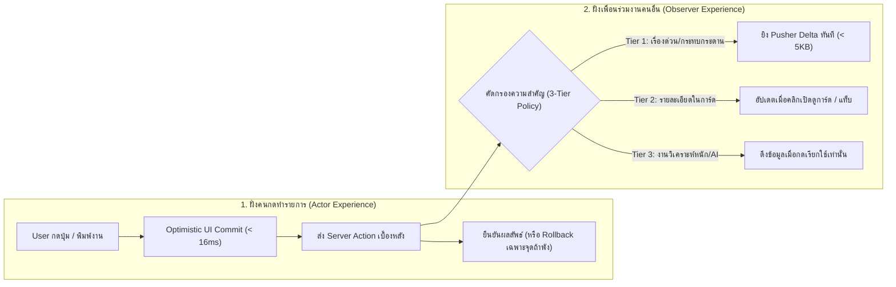
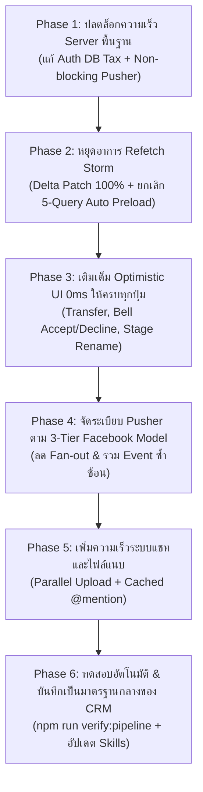

# Pipeline Real-Time Architecture & Latency Elimination Master Plan (Facebook-Style Tiered Model)

> **Status**: MASTER ARCHITECTURE & EXECUTION PLAN (Ready for Phase-by-Phase Implementation)
> **Created Date**: 2026-10-16 (Asia/Bangkok)
> **Scope**: `http://localhost:3003/pipeline` (`KanbanBoard`, `EditDealPanel` & all 8 sub-tabs, Global Header Notifications, Server Actions, Pusher WebSocket Lifecycle, and Cross-Tab Synchronization) + Architectural Standard for the entire CRM (`/contact`, `/product`, `/calendar`, `/dashboard/overview`).
> **Companion Standards**:
> - `.agents/skills/pipeline-deal-panel-architecture/SKILL.md`
> - `.agents/skills/pusher-management/SKILL.md` & `references/pusher-management.md`
> - `.agents/plans/pipeline-action-performance-plan.md`

---

## 1. บทสรุปผู้บริหารและปรัชญาการออกแบบ (Executive Summary & Core Philosophy)

### 1.1 ปัญหาที่พบจากผู้ใช้งานจริง (User Pain Point)
ผู้ใช้งานระบบ CRM รายงานตรงกันว่า **"บาง Action ในหน้า `/pipeline` มีอาการหน่วง ช้า หรือดีเลย์ จนเข้าใจผิดว่าแอปค้างหรือเกิด Error"** ส่งผลให้ผู้ใช้กดซ้ำ ปิด-เปิดหน้าต่างใหม่ หรือไม่มั่นใจว่างานที่ทำถูกบันทึกแล้วหรือยัง

### 1.2 ความเข้าใจผิดเรื่อง "Real-Time" vs. ความลับของ "Facebook App Model"
ในระบบที่ซับซ้อน การทำให้ **"ทุกอย่างส่งผ่าน WebSocket (Pusher) หาทุกคนตลอดเวลา"** ไม่ได้ทำให้แอปเร็วขึ้น แต่กลับทำให้แอป **ช้าลงและพังง่ายขึ้น** เพราะเกิดคอขวดที่ Server, เกิดอาการกระตุกจากการดึงข้อมูลทับกัน (Refetch Storm), และทำให้โควตา Pusher เต็ม (`Error 4004`)

แอปพลิเคชันระดับโลกอย่าง **Facebook, Messenger, Linear และ Notion** ใช้หลักการแยกแยะ **2 มิติออกจากกันอย่างเด็ดขาด**:

1. **ความเร็วของ "คนกด (Actor)" ต้องเกิดจาก Optimistic UI (0–16ms) เท่านั้น ไม่ใช่รอ WebSocket!**
   - เมื่อผู้ใช้กดปุ่ม หน้าจอของผู้ใช้คนนั้นต้องเปลี่ยนทันทีและปลดล็อกให้ทำงานต่อได้เลย โดยไม่ต้องรอให้ Server คิวรีฐานข้อมูลหรือยิง Pusher เสร็จ
2. **การส่งข้อมูลสดให้ "คนอื่น (Collaborators)" ต้องคัดกรองเฉพาะเรื่องที่สำคัญ (Selective Real-Time Push)**
   - ส่งผ่าน Pusher เฉพาะเหตุการณ์ที่เพื่อนร่วมงานต้องเห็นเดี๋ยวนั้นเพื่อไม่ให้ทำงานชนกัน (เช่น การย้ายการ์ดบนบอร์ด, แชท/คอมเมนต์ใหม่, คำสั่ง Manager Call, กระดิ่งแจ้งเตือน)
   - ส่วนข้อมูลรายละเอียดภายใน (เช่น แก้เลข Invoice, แก้ราคา, จัดการ To-Do ย่อย) ให้ใช้การซิงค์แบบประหยัด (Delta Patch เฉพาะจุด หรือโหลดเมื่อเปิดดู)

---

## 2. การจำแนกประเภทสัญญาณข้อมูลใน CRM (The 4 Signal Types)

เพื่อให้ทีมพัฒนาและ AI Agent มีภาพความเข้าใจเดียวกัน ทุกๆ การกระทำในระบบ CRM จะถูกจำแนกออกเป็น **4 ประเภทสัญญาณ (Signal Types)** ที่ห้ามนำมาปะปนกัน:

| ประเภทสัญญาณ (Signal Type) | นิยามและหน้าที่ | กลไกทางเทคนิค (Mechanism) | ตัวอย่างในหน้า `/pipeline` |
| :--- | :--- | :--- | :--- |
| **1. Local Optimistic Feedback** | การตอบสนองต่อ **"ผู้กดทำรายการ"** ให้เห็นผลทันทีโดยไม่รู้สึกว่าแอปค้าง | อัปเดต Local State + SWR Cache (`{ revalidate: false }`) ภายใน `< 16ms` พร้อม `mutationId` และฟังก์ชัน Rollback เฉพาะจุด | ลากการ์ด, พิมพ์คอมเมนต์, ติ๊ก To-Do, แก้ชื่อดีล, กดโอนงาน, กดรับงาน |
| **2. Business Notification (Persistent Inbox)** | การแจ้งเตือนเข้า **"กระดิ่ง"** สำหรับเรื่องที่ผู้รับต้อง **"ตัดสินใจหรือลงมือทำ"** | บันทึกลงตาราง `Notification` ใน Neon Postgres ก่อนเสมอ แล้วส่ง Pusher ช่อง `private-user-${userId}` (`new-notification`) | ขอโอนย้ายดีล (`DEAL_TRANSFER`), เชิญเข้าทีม (`TEAM_INVITE`), คำถามด่วน (`MANAGER_CALL`), การแท็กชื่อ (`@mention`) |
| **3. Realtime Data Event (Collaborative Delta)** | การอัปเดตหน้าจอของ **"เพื่อนร่วมงานที่เปิดดูหน้าเดียวกันอยู่"** ให้เห็นข้อมูลตรงกันโดยไม่ต้องกด Refresh | ส่ง Payload ขนาดเล็ก (`< 5KB` Delta DTO) ผ่านช่อง `private-pipeline-${userId}` (`pipeline-updated`) แล้ว Merge เข้า SWR Cache โดยตรง **ห้ามสั่ง `mutate()` ดึงใหม่ทั้งบอร์ด** | การ์ดถูกย้าย Stage, มีการ์ดใหม่, การ์ดถูกปิด Won/Lost, มีคอมเมนต์ใหม่ในดีลที่เปิดอยู่ |
| **4. On-Demand / Lazy Resource (Pull Snapshot)** | ข้อมูลรายละเอียดเชิงลึกหรือข้อมูลวิเคราะห์ที่ไม่ต้องส่ง Push ปลุกทุกคนทุกวินาที | ดึงผ่าน SWR (`useSWR` / `useSWRInfinite`) เฉพาะเมื่อผู้ใช้คลิกเปิดการ์ด หรือคลิกเข้าแท็บนั้นๆ | แท็บ `Information` (ข้อมูลบริษัท/ที่อยู่), แท็บ `Shared Media`, แท็บ `Summary` (AI), แท็บ `System` (Audit Logs), ตาราง `LTC` |

---

## 3. โครงสร้างการจัดลำดับชั้น Real-Time 3 ระดับ (The 3-Tier Real-Time Standard)

นี่คือมาตรฐานใหม่ของหน้า `/pipeline` (และเป็นต้นแบบให้ทุกหน้าใน CRM) โดยแบ่งทุก Action ออกเป็น 3 Tiers ตามแนวคิด Facebook App:

### 🟢 Tier 1: Critical Collaborative Real-Time (Optimistic 0ms + Pusher Delta Push ทันที)
* **เกณฑ์การคัดเลือก**: เป็น Action ที่เปลี่ยนโครงสร้างกระดาน Kanban ที่ทุกคนมองเห็นร่วมกัน หรือเป็นการสื่อสารสด/คำสั่งด่วนระหว่างสมาชิกในทีม
* **การทำงาน**:
  1. **ฝั่งคนกด**: อัปเดต UI ทันทีใน `0ms` (Optimistic)
  2. **ฝั่ง Server**: บันทึก DB ใน Transaction ที่กระชับ คืนค่ากลับให้คนกดทันที และกระจาย Pusher Delta Event ไปยังผู้ที่มีสิทธิ์เห็นการ์ดใบนั้น
  3. **ฝั่งคนรับ**: นำ Delta Payload ไปอัปเดตเฉพาะการ์ดใบนั้นใน SWR Cache (`{ revalidate: false }`) **ห้ามสั่งดึงข้อมูลทั้งบอร์ดใหม่เด็ดขาด**
* **รายการ Action ใน Tier 1**:
  - การสร้างการ์ดใหม่ (`OPPORTUNITY_CREATED`)
  - การลากย้าย Stage / ปิดดีล Won / ปิดดีล Lost (`OPPORTUNITY_MOVED`)
  - การลบการ์ด (`OPPORTUNITY_DELETED`)
  - การโพสต์คอมเมนต์ใหม่ / ตอบกลับคอมเมนต์ / ลบคอมเมนต์ (`ACTIVITY_ADDED`, `ACTIVITY_DELETED`)
  - การตั้งหรือเลื่อนวันนัดหมาย (`DUE_DATE_UPDATED`)
  - การส่งคำถามด่วน Manager Call และการกดตอบคำถาม (`DEAL_ACCELERATORS_UPDATED` ที่เปลี่ยนสถานะกรอบสีส้มบนการ์ด)
  - การเชิญสมาชิกเข้าทีม / ลบสมาชิก / โอนย้ายเจ้าของดีล (`MEMBERS_ADDED`, `MEMBER_REMOVED`, `DEAL_TRANSFER`)

### 🟡 Tier 2: Instant Local + Scoped Sync (Optimistic 0ms สำหรับคนกด + ซิงค์แบบประหยัดสำหรับคนอื่น)
* **เกณฑ์การคัดเลือก**: เป็นการแก้ไขข้อมูลรายละเอียดด้านในการ์ด หรือการตั้งค่าที่ไม่ได้กระทบการทำงานร่วมกันแบบวินาทีต่อวินาทีบนกระดานหลัก
* **การทำงาน**:
  1. **ฝั่งคนกด**: อัปเดต UI และ SWR Cache ทันทีใน `0ms`
  2. **ฝั่งคนอื่น**:
     - หากส่งผ่าน Pusher ต้องส่งเฉพาะ **Minimal Field Patch** (เช่น `{ id, value, currency }` หรือ `{ dealId, noteDelta }`) เพื่อให้ผู้ที่เปิดการ์ดใบนั้นอยู่เห็นตัวเลขเปลี่ยน **โดยห้ามสั่ง `mutatePendingTodos()` หรือ `mutate('pipeline-deals')` ที่ดึงข้อมูลใหม่จาก DB เด็ดขาด**
     - สำหรับข้อมูลที่ไม่ได้แสดงบนหน้าการ์ด Kanban (เช่น `reserveId`, `invoiceId`, `goodsReadyDate`, การแก้คำผิดในคอมเมนต์เก่า, การเปลี่ยนชื่อหัวคอลัมน์ Stage, การแก้ค่า LTC) ไม่จำเป็นต้องยิง Pusher ปลุกทุกคนในแผนก ให้ซิงค์เมื่อคนอื่นคลิกเปิดดูการ์ดหรือรีเฟรชหน้าตามรอบปกติ
* **รายการ Action ใน Tier 2**:
  - การบันทึกข้อมูลในแท็บ `Information` (`CustomerTab`: ราคา, สกุลเงิน, วันที่ผลิต/โหลดสินค้า, Reserve ID, Invoice ID)
  - การแปลงประเภทการ์ด (`Convert Sales Deal <-> Internal Task`)
  - การจัดการรายการ `To-Do Notes` (เพิ่ม, ลบ, ปักหมุดไฟลุก, ขีดฆ่าว่าเสร็จ)
  - การแก้ไขข้อความในคอมเมนต์เดิม (`ACTIVITY_UPDATED`)
  - การเปลี่ยนชื่อหัวคอลัมน์ประจำแผนก (`Rename Stage Column`)
  - การแก้ไขค่าเป้าหมายวันใน `LTC Drawer`

### 🔵 Tier 3: Pure On-Demand / Pull-Only (โหลดเมื่อคลิกเปิดดูเท่านั้น)
* **เกณฑ์การคัดเลือก**: ข้อมูลที่มีขนาดใหญ่ ข้อมูลประวัติย้อนหลัง หรืองานประมวลผล AI ที่ใช้เวลาหลายวินาที
* **การทำงาน**:
  - **ห้าม Preload ล่วงหน้าตอนเปิดหน้าบอร์ด** และ **ห้ามส่งข้อมูลก้อนใหญ่ผ่าน Pusher**
  - ดึงข้อมูลผ่าน SWR เฉพาะเมื่อผู้ใช้คลิกเปิดแท็บนั้นๆ (`activeTab === '...'`) และเมื่อสลับออกจากแท็บต้อง Unmount เพื่อคืนหน่วยความจำทันที (ตามกฎ Pillar 1 & Pillar 3)
* **รายการ Action ใน Tier 3**:
  - แท็บ `Summary` (AI Deal Summary & Prompt Editor)
  - การกดปุ่ม `Recall` เพื่อให้ Gemini AI วิเคราะห์คำถามคอขวดใหม่
  - แท็บ `Shared Media` (คลังรูปภาพ, ลิงก์, เอกสารแนบ)
  - แท็บ `System` (ประวัติ System Audit Logs)
  - รายละเอียดบัญชีลูกค้าและผู้ติดต่อในแท็บ `Information` (`getAccountOverview`)

---

## 4. ตารางวิเคราะห์ครบทุก Action & Notification ในหน้า `/pipeline` (22 รายการ)

ตารางด้านล่างนี้สรุปสถานะปัจจุบันของทุก Action ในหน้า `/pipeline` พร้อมระบุจุดคอขวดและแนวทางแก้ไขตามมาตรฐานใหม่:

| # | หมวด | Action / Notification | ไฟล์หลักที่รับผิดชอบ | สถานะฝั่งคนกด (ปัจจุบัน) | สถานะฝั่งคนอื่น (ปัจจุบัน) | คอขวดที่ทำให้ช้า / ปัญหาที่พบ | Tier เป้าหมาย | แนวทางแก้ไข (Target Architecture) |
| :-: | :--- | :--- | :--- | :--- | :--- | :--- | :-: | :--- |
| **1** | Board | **ลากย้ายการ์ดข้ามคอลัมน์ (Drag & Drop Stage)** | [`KanbanBoard.tsx`](file:///Users/light/my-crm/src/components/pipeline/KanbanBoard.tsx) [`opportunity.ts`](file:///Users/light/my-crm/src/lib/actions/opportunity.ts) | Optimistic (0ms) | Pusher (`OPPORTUNITY_MOVED`) | 1) Server รอ `await notifyPrivatePipelineUpdate` ก่อนตอบกลับ 2) แท็บอื่นที่รับผ่าน `BroadcastChannel` สั่ง `mutate()` ดึงบอร์ดใหม่ทั้งก้อน | **Tier 1** | แยกงานส่ง Pusher ไม่ให้บล็อก Response และแก้ `BroadcastChannel` ให้ทำ Delta Patch แทนการดึงบอร์ดใหม่ |
| **2** | Board | **สร้างการ์ดใหม่ (+ New Card)** | [`CreateDealButton.tsx`](file:///Users/light/my-crm/src/components/pipeline/CreateDealButton.tsx) [`opportunity.ts`](file:///Users/light/my-crm/src/lib/actions/opportunity.ts) | Optimistic (0ms) | Pusher (`OPPORTUNITY_CREATED`) | กว่าจะขึ้น Toast "Created successfully" ต้องรอ Auth DB 2 รอบ + Create + Pusher เสร็จ (~1.5 วิ) | **Tier 1** | แสดงผลทันที และลดเวลา Server Action ด้วยการตัด Auth DB ซ้ำซ้อน + Non-blocking Pusher |
| **3** | Board | **ปักหมุดดาวบนการ์ด (Star / Pin Card)** | [`KanbanCard.tsx`](file:///Users/light/my-crm/src/components/pipeline/KanbanCard.tsx) [`opportunity.ts`](file:///Users/light/my-crm/src/lib/actions/opportunity.ts) | Optimistic (SWR) | Pusher (`OPPORTUNITY_UPDATED`) | `KanbanBoard` มี state `deals` แยกจาก SWR cache บางจังหวะทำให้ดาวแสดงผลช้า และ Server ดึง DTO ทั้งก้อน | **Tier 2** | ซิงค์ Local state + SWR ทันทีในเฟรมแรก และส่งเฉพาะ `{ id, isStarred }` ไม่ต้องดึง DTO ใหญ่ |
| **4** | Board | **เปลี่ยนชื่อหัวคอลัมน์ (Rename Stage Title)** | [`KanbanColumn.tsx`](file:///Users/light/my-crm/src/components/pipeline/KanbanColumn.tsx) [`pipeline-stage-title.ts`](file:///Users/light/my-crm/src/lib/actions/pipeline-stage-title.ts) | **Blocking (หมุนรอ Server)** | ไม่มี Real-Time | กด Save แล้วช่อง Input ค้างหมุนรอ DB ตอบกลับ 1–2 วินาที | **Tier 2** | เปลี่ยนเป็น Optimistic UI (ปิดช่องแก้ไขและเปลี่ยนชื่อทันทีใน `0ms`) ถ้าพังค่อย Rollback |
| **5** | Board | **ตั้งค่าตาราง LTC (Lead Time Control)** | [`LtcDrawer.tsx`](file:///Users/light/my-crm/src/components/pipeline/LtcDrawer.tsx) | Optimistic ใน Drawer | ไม่มี Real-Time | ทำงานได้ดีอยู่แล้ว แต่โดนภาษีแฝง Auth DB ตอนบันทึก | **Tier 2** | คงรูปแบบ On-Demand + Optimistic ใน Drawer (ลดเวลา Server ด้วยการแก้ Auth Tax) |
| **6** | Header | **แก้ชื่อหัวข้อดีล (Edit Deal Topic)** | [`EditDealPanel.tsx`](file:///Users/light/my-crm/src/components/pipeline/EditDealPanel.tsx) [`opportunity.ts`](file:///Users/light/my-crm/src/lib/actions/opportunity.ts) | Optimistic (0ms) | Pusher (`OPPORTUNITY_UPDATED`) | `updateOpportunity` ใช้ `Serializable` Transaction + ดึง DTO ใหม่ทั้งก้อน + รอ Pusher ทำให้ Toast ดีเลย์ 1–2.5 วิ | **Tier 1** | ใช้ ReadCommitted + Atomic Update สำหรับฟิลด์ทั่วไป และไม่ต้องรอ Pusher ก่อนคืนค่า |
| **7** | Actions | **ปิดดีล Mark as Won / Mark as Lost** | [`DealActionsDrawer.tsx`](file:///Users/light/my-crm/src/components/pipeline/DealActionsDrawer.tsx) [`opportunity.ts`](file:///Users/light/my-crm/src/lib/actions/opportunity.ts) | Optimistic (0ms) | Pusher (`OPPORTUNITY_MOVED`) | ยิง Pusher ทั้ง Pipeline และ Dashboard แบบบล็อก Response | **Tier 1** | คง Optimistic 0ms และย้ายการยิง Pusher/Dashboard Invalidation ไปทำหลังส่ง Response |
| **8** | Actions | **แปลงประเภทการ์ด (Convert Sales $\leftrightarrow$ Internal)** | [`DealActionsDrawer.tsx`](file:///Users/light/my-crm/src/components/pipeline/DealActionsDrawer.tsx) [`opportunity.ts`](file:///Users/light/my-crm/src/lib/actions/opportunity.ts) | Optimistic (0ms) | Pusher (`OPPORTUNITY_UPDATED`) | หลัง `updateOpportunity` เสร็จ มีการสั่ง `mutate(["opportunity", deal.id])` ซ้ำโดยไม่จำเป็น | **Tier 2** | อัปเดตผ่าน Delta Patch เฉพาะฟิลด์ `type` โดยไม่ต้องสั่ง Refetch ซ้ำ |
| **9** | Actions | **ลบการ์ดถาวร (Delete Card)** | [`DealActionsDrawer.tsx`](file:///Users/light/my-crm/src/components/pipeline/DealActionsDrawer.tsx) [`opportunity.ts`](file:///Users/light/my-crm/src/lib/actions/opportunity.ts) | Optimistic (0ms) | Pusher (`OPPORTUNITY_DELETED`) | Server วนลูปลบไฟล์บน Cloudinary ทีละไฟล์แบบ `await` ก่อนลบใน DB | **Tier 1** | ลบข้อมูลใน DB และแจ้ง Pusher ทันที ส่วนการกวาดลบไฟล์บน Cloudinary ให้รันเป็น Background Cleanup |
| **10** | Activity | **โพสต์คอมเมนต์ข้อความ & `@mention`** | [`ActivityFeedTab.tsx`](file:///Users/light/my-crm/src/components/pipeline/ActivityFeedTab.tsx) [`pipeline-activity-service.ts`](file:///Users/light/my-crm/src/lib/pipeline-activity-service.ts) | Optimistic (0ms) | Pusher (`ACTIVITY_ADDED` + Bell `DEAL_COMMENT`) | ถ้ามี `@mention` โค้ดสั่ง `prisma.user.findMany()` ดึง User **ทุกคนในระบบ** มาวนลูปเช็คชื่อทุกครั้ง! | **Tier 1** | คิวรีเฉพาะ User ที่เกี่ยวข้องหรือใช้ Cached User Directory ในหน่วยความจำแทนการดึงทั้งตาราง |
| **11** | Activity | **โพสต์คอมเมนต์พร้อมรูปภาพ/ไฟล์แนบ** | [`ActivityFeedTab.tsx`](file:///Users/light/my-crm/src/components/pipeline/ActivityFeedTab.tsx) `/api/upload/opportunity` | Optimistic (โชว์รูป Preview ทันที) | Pusher (`ACTIVITY_ADDED`) | อัปโหลดไฟล์แบบเรียงคิวทีละไฟล์ (`for...of`) แปลงเป็น Base64 ยิงผ่าน JSON ถ้ารูปเยอะจะช้ามาก | **Tier 1** | เปลี่ยนเป็น `Promise.all` (Parallel Upload ครั้งละ 3 ไฟล์) เพื่อลดเวลาอัปโหลดลง 60–70% |
| **12** | Activity | **ตั้ง/เลื่อน Due Date พร้อมเหตุผล** | [`ActivityFeedTab.tsx`](file:///Users/light/my-crm/src/components/pipeline/ActivityFeedTab.tsx) [`opportunity.ts`](file:///Users/light/my-crm/src/lib/actions/opportunity.ts) | Optimistic (0ms) | Pusher (`DUE_DATE_UPDATED` + `ACTIVITY_ADDED`) | ยิง `notifyPrivatePipelineUpdate` 2 รอบติดกันใน Action เดียว (เปลืองโควตา Pusher 2 เท่า) | **Tier 1** | รวมเป็น Event เดียว (`DUE_DATE_UPDATED` ที่แนบ `activityLog` มาด้วยในก้อนเดียว) |
| **13** | Activity | **ตอบกลับ (Reply) / แก้ไข / ลบคอมเมนต์** | [`ActivityCommentItem.tsx`](file:///Users/light/my-crm/src/components/pipeline/ActivityCommentItem.tsx) [`opportunity.ts`](file:///Users/light/my-crm/src/lib/actions/opportunity.ts) | Optimistic (0ms) | Pusher (`ACTIVITY_*`) | การแก้ไขคำผิดในคอมเมนต์เก่า (`ACTIVITY_UPDATED`) ยิง Pusher ปลุกทุกคนในแผนกแม้ไม่ได้เปิดการ์ดดู | **Tier 1 / 2** | Reply/Delete คง Tier 1; ส่วน Edit ข้อความอัปเดตเฉพาะคนที่เปิดดูดีลนั้นอยู่ |
| **14** | Manager | **ส่งคำถามด่วน Manager Call / ตอบคำถาม / ลบ** | [`ActivityFeedTab.tsx`](file:///Users/light/my-crm/src/components/pipeline/ActivityFeedTab.tsx) [`ai-accelerator.ts`](file:///Users/light/my-crm/src/lib/actions/ai-accelerator.ts) | Optimistic (0ms) | Pusher (`DEAL_ACCELERATORS_UPDATED` + Bell) | ทำงานฝั่ง UI เร็วแล้ว แต่ฝั่ง Server รอส่ง Bell + Pusher ครบทุกคนก่อนจบฟังก์ชัน | **Tier 1** | คง Optimistic 0ms + ส่ง Persistent Bell เฉพาะผู้รับผิดชอบ และทำ Pusher Dispatch แบบไม่บล็อก |
| **15** | Manager | **กดปุ่ม Recall (ให้ AI วิเคราะห์คอขวดดีล)** | [`EditDealPanel.tsx`](file:///Users/light/my-crm/src/components/pipeline/EditDealPanel.tsx) [`ai-accelerator.ts`](file:///Users/light/my-crm/src/lib/actions/ai-accelerator.ts) | On-Demand (Loading) | Pusher (`DEAL_ACCELERATORS_UPDATED`) | ต้องรอ Gemini API 3–6 วินาที (ปกติของ AI) แต่ไม่ควรยิง Pusher ปลุกคนอื่นถ้าคำถามไม่เปลี่ยน | **Tier 3** | ยิง Pusher เฉพาะเมื่อสร้างคำถาม Pending ใหม่สำเร็จเท่านั้น |
| **16** | Collab | **เชิญสมาชิกเข้าการ์ด / ลบสมาชิกออกจากทีม** | [`useDealMembersMutation.ts`](file:///Users/light/my-crm/src/hooks/useDealMembersMutation.ts) [`opportunity.ts`](file:///Users/light/my-crm/src/lib/actions/opportunity.ts) | Optimistic (0ms) | Pusher (`MEMBERS_ADDED` / `REMOVED` + Bell) | ฝั่ง UI มี Granular Rollback ที่ดีมากแล้ว เหลือแค่ลดเวลา Auth Tax และ Non-blocking Pusher ฝั่ง Server | **Tier 1** | ใช้เป็น **Reference Pattern (ต้นแบบมาตรฐาน)** ให้กับ Action อื่นๆ ในระบบ |
| **17** | Collab | **ขอโอนย้ายเจ้าของดีล (Transfer Ownership)** | [`EditDealPanel.tsx`](file:///Users/light/my-crm/src/components/pipeline/EditDealPanel.tsx) [`notification.ts`](file:///Users/light/my-crm/src/lib/actions/notification.ts) | **Blocking 100% (ค้างรอ Server 1–3 วิ)** | Pusher Bell (`DEAL_TRANSFER`) | **จุดที่ลูกค้าบ่นว่าค้าง!** กดยืนยันแล้ว Drawer ไม่ปิดทันที ต้องรอ Serializable DB + Pusher เสร็จก่อน | **Tier 1** | **เปลี่ยนเป็น Optimistic 0ms**: ปิด Drawer ทันที + แสดงสถานะ "Pending Transfer" + ยิง Server เบื้องหลัง |
| **18** | Bell | **กดรับ / ปฏิเสธการโอนดีลในกระดิ่ง (Accept / Decline)** | [`Header.tsx`](file:///Users/light/my-crm/src/components/layout/Header.tsx) [`notification.ts`](file:///Users/light/my-crm/src/lib/actions/notification.ts) | **Blocking 100% (ค้างรอ Server)** | Pusher (`RECONCILE_OPPORTUNITY` + `notification-resolved`) | **จุดที่ทำให้ทั้งบอร์ดกระตุก!** 1) กดปุ่มแล้วต้องรอ Server 2) ส่ง `RECONCILE_OPPORTUNITY` ไปที่ `KanbanBoard` ซึ่งตกเข้า `else { mutate(); }` **สั่งโหลดข้อมูลทั้งบอร์ดใหม่!** | **Tier 1** | 1) ทำ Optimistic UI บนกระดิ่งทันที (0ms) 2) เพิ่ม Handler รับ `RECONCILE_OPPORTUNITY` ใน `KanbanBoard` ให้ Patch เฉพาะการ์ดใบนั้น (`deal`) ห้ามสั่ง `mutate()` ทั้งบอร์ด! |
| **19** | Info | **บันทึกข้อมูลการเงิน/วันที่ผลิต (`CustomerTab` Save)** | [`CustomerTab.tsx`](file:///Users/light/my-crm/src/components/pipeline/CustomerTab.tsx) [`opportunity.ts`](file:///Users/light/my-crm/src/lib/actions/opportunity.ts) | Optimistic (0ms) | Pusher (`OPPORTUNITY_UPDATED`) | พอบันทึกเสร็จ บรรทัด 163 สั่ง `mutate("pipeline-deals")` **ดึงข้อมูลดีลทั้งหมดบนบอร์ดซ้ำอีกรอบ!** | **Tier 2** | ลบคำสั่ง `mutate("pipeline-deals")` ที่ดึงใหม่ทั้งบอร์ดออก! ใช้ค่าที่เพิ่งส่งกลับมาจาก `updateOpportunity` อัปเดตเฉพาะการ์ดใบนั้นแทน |
| **20** | Notes | **เพิ่ม / ลบ / ปักหมุด / ขีดฆ่า To-Do Note** | [`NotesTab.tsx`](file:///Users/light/my-crm/src/components/pipeline/NotesTab.tsx) [`notes.ts`](file:///Users/light/my-crm/src/lib/actions/notes.ts) | Optimistic (0ms) | Pusher (`NOTE_ADDED` / `UPDATED` / `DELETED`) | **จุดคอขวดแฝงร้ายแรง!** ทุกครั้งที่ใครแก้ Note 1 ข้อ ทั้งคนกดและทุกคนที่รับ Pusher จะสั่ง `getPendingTodosMap(allDealIds)` **คิวรี DB ดึง To-Do ของทุกการ์ดทั้งบอร์ดใหม่!** | **Tier 2** | **ห้ามดึง `getPendingTodosMap` ใหม่ทั้งบอร์ด!** ให้เขียน Helper อัปเดต `pendingTodosMap[dealId]` ในหน่วยความจำโดยตรงจาก Note ที่เปลี่ยน (`{ revalidate: false }`) |
| **21** | Summary | **สร้างสรุปดีลด้วย AI (Re-Summarize)** | [`DealSummaryTab.tsx`](file:///Users/light/my-crm/src/components/pipeline/DealSummaryTab.tsx) [`deal-summary.ts`](file:///Users/light/my-crm/src/lib/actions/deal-summary.ts) | On-Demand (Loading) | Pusher (`DEAL_SUMMARY_UPDATED`) | เวลาまだไม่มี Accelerator โค้ดแอบสั่ง `generateDealAccelerators` ซ้อนไปพร้อมกับ `generateDealSummary` (เรียก Gemini 2 ตัวพร้อมกัน) | **Tier 3** | แยกการทำงานออกจากกัน กดปุ่มไหนให้รันเฉพาะ AI ตัวนั้น และไม่ต้องยิง Pusher ปลุกทั้งบอร์ด |
| **22** | Media / System | **เปิดดูรูปภาพ/ไฟล์ (`SharedMediaTab`) & ประวัติ (`DealSystemLogsTab`)** | [`SharedMediaTab.tsx`](file:///Users/light/my-crm/src/components/pipeline/SharedMediaTab.tsx) [`DealSystemLogsTab.tsx`](file:///Users/light/my-crm/src/components/pipeline/DealSystemLogsTab.tsx) | On-Demand | Invalidate เมื่อมีคอมเมนต์ใหม่ | ใน `EditDealPanel.tsx` บรรทัด 293 มี `primeActiveDealData` ที่แอบ Preload `Notes`, `AccountOverview`, `SharedMedia`, `DealSummary`, `AllUsers` พร้อมกัน 5 Queries ทันทีที่เปิดการ์ดทุกใบ! | **Tier 3** | **ยกเลิกการยิง 5 Queries พร้อมกันทุกครั้งที่คลิกเปิดการ์ด!** ให้ Preload เฉพาะเมื่อผู้ใช้เอาเมาส์ชี้ที่ปุ่มแท็บนั้น (`onMouseEnter`) หรือคลิกเข้าแท็บจริง (ตามกฎ Pillar 3) |

---

## 5. การวินิจฉัยต้นตอความช้าเชิงลึก 6 จุดตาย (Deep-Dive Root Cause Analysis)

เพื่อให้การแก้ไขครั้งนี้ยั่งยืนและไม่กลับมาช้าอีก นี่คือหลักฐานระดับโค้ดของต้นตอทั้ง 6 จุดที่ต้องได้รับการแก้ไขอย่างเป็นระบบ:

### 🔴 จุดตายที่ 1: "ภาษีแฝง (Hidden Auth DB Tax)" ยิงฐานข้อมูลซ้ำ 2–3 รอบในทุกๆ การกดปุ่ม
* **หลักฐานในโค้ด**:
  1. ใน [`src/lib/auth.ts`](file:///Users/light/my-crm/src/lib/auth.ts#L74-L91): ฟังก์ชัน `callbacks.jwt` ถูกเขียนให้รัน `await prisma.user.findUnique({ where: { id: token.sub }, include: { departments: true } })` **ทุกครั้งที่มีการเรียก `getServerSession(authOptions)`**
  2. ใน [`src/lib/pipeline-security.ts`](file:///Users/light/my-crm/src/lib/pipeline-security.ts#L76-L95): ฟังก์ชัน `getPipelineActor()` เรียก `await getServerSession(authOptions)` (โดน DB รอบที่ 1) แล้วบรรทัดถัดมาสั่ง `await prisma.user.findUnique({ where: { id: sessionUser.id }, include: { departments: true } })` **ซ้ำเป็นรอบที่ 2 ด้วยคำสั่งเดียวกันเป๊ะ!**
* **ผลกระทบ**: ทุก Server Action ในระบบต้องเสียเวลาวิ่งไป-กลับฐานข้อมูล Neon Postgres 2 รอบฟรีๆ (`300ms – 800ms`) ก่อนที่จะเริ่มทำคำสั่งจริง!
* **วิธีแก้ที่ยั่งยืน**:
  1. ใน `getPipelineActor()`: ใช้ข้อมูล `role`, `departments`, `departmentIds` ที่ถูกซิงค์ไว้ใน `session.user` แล้ว (หรือใช้ `React.cache()` + Short-lived Server Memory Cache `5–10 วินาที` พร้อม Invalidate เมื่อแก้สิทธิ์) เพื่อไม่ให้ยิง `prisma.user.findUnique` ซ้ำ 2 รอบใน Request เดียว
  2. ใน `auth.ts` (`jwt` callback): กำหนด TTL ในการรีเฟรชข้อมูล User จาก DB (เช่น เช็ค DB ทุกๆ `30–60 วินาที` แทนที่จะเช็คทุกมิลลิวินาทีของการกดปุ่ม ยกเว้นเมื่อ `trigger === "update"`)

### 🔴 จุดตายที่ 2: การเปิดการ์ด 1 ใบ แอบยิง 6 Server Actions พร้อมกันข้างหลัง (`primeActiveDealData` Contention)
* **หลักฐานในโค้ด**:
  - ใน [`EditDealPanel.tsx`](file:///Users/light/my-crm/src/components/pipeline/EditDealPanel.tsx#L288-L324): ทันทีที่ผู้ใช้คลิกเปิดการ์ด 1 ใบ นอกจากจะโหลด `getOpportunityActivityLogs` แล้ว ฟังก์ชัน `primeActiveDealData()` จะถูกปลุกใน `250ms` เพื่อยิง Server Actions อีก **5 ตัวพร้อมกัน**:
    1. `getNotes(deal.id)`
    2. `getAccountOverview(companyId)`
    3. `getOpportunitySharedMedia(deal.id)`
    4. `getLatestDealSummary(deal.id)`
    5. `getAllUsers()`
* **ผลกระทบ**:
  - ใน Next.js App Router การเรียก Server Actions หลายตัวพร้อมกันและติด Auth DB Tax ตัวละ 2 รอบ ทำให้เกิดการแย่ง Connection Pool ไปยัง Neon Postgres (รวมกว่า **12–15 DB Queries** ต่อการคลิกดูการ์ดแค่ใบเดียว!)
  - หากผู้ใช้คลิกเปิดการ์ดแล้วพิมพ์คอมเมนต์หรือกดปุ่มทันที คำสั่งของผู้ใช้จะไปต่อคิวหลังการ Preload ทั้ง 5 ตัวนี้ ทำให้รู้สึกว่าแอปหน่วง!
  - นอกจากนี้ พฤติกรรมนี้ยัง **ขัดกับกฎเหล็ก Pillar 3** ของ `.agents/skills/pipeline-deal-panel-architecture/SKILL.md` ที่ระบุไว้ชัดเจนว่า *"NEVER preload heavy content (AI Summary, Shared Media list, Activity logs, Notes) on deal card open"*
* **วิธีแก้ที่ยั่งยืน**:
  - เอา `primeActiveDealData` ที่ยิงรวดเดียวตอนเปิดการ์ดออก และเปลี่ยนไปใช้ **Intent-Based Preload** (โหลดเฉพาะเมื่อผู้ใช้เลื่อนเมาส์ไปชี้ `onMouseEnter` หรือ `onFocus` ที่ไอคอนแท็บใน Sidebar เท่านั้น) ยกเว้น `dealNotes` ที่หากต้องใช้แสดงจำนวนบนแบนเนอร์ในแท็บ Activity ให้ส่ง `pendingTodosCount` มาจาก `pendingTodosMap` ที่มีอยู่แล้วบนบอร์ดได้เลยโดยไม่ต้องคิวรีซ้ำ!

### 🔴 จุดตายที่ 3: อาการ "Refetch Storm" (แก้ข้อมูลจุดเดียว แต่สั่งดึงข้อมูลใหม่ทั้งกระดาน)
พบทั้งหมด **4 จุด** ในโค้ดปัจจุบันที่แอบสั่งดึงข้อมูลใหม่ทั้งบอร์ด:
1. **`NOTE_*` สั่งดึง To-Do ใหม่ทั้งกระดาน**:
   - ใน [`KanbanBoard.tsx`](file:///Users/light/my-crm/src/components/pipeline/KanbanBoard.tsx#L700-L702) และ [`NotesTab.tsx`](file:///Users/light/my-crm/src/components/pipeline/NotesTab.tsx#L176): ทุกครั้งที่มีการเพิ่ม/ลบ/ติ๊กถูก To-Do 1 ข้อ จะสั่ง `mutatePendingTodos()` ซึ่งไปเรียก `getPendingTodosMap(allDealIds)` ดึง To-Do ของทุกการ์ดบนบอร์ดใหม่ทั้งหมด
   - **วิธีแก้**: อัปเดต `pendingTodosMap[dealId]` ใน SWR Cache แบบ In-Memory Delta (`{ revalidate: false }`) ทันทีโดยไม่ยิง DB!
2. **`RECONCILE_OPPORTUNITY` ตกเข้า `else { void mutate(); }`**:
   - เมื่อมีคนกดรับ/ปฏิเสธการโอนดีล [`respondToNotification`](file:///Users/light/my-crm/src/lib/actions/notification.ts#L311) จะส่ง Pusher action ชื่อ `RECONCILE_OPPORTUNITY` พร้อม `deal` ก้อนใหม่มาให้แล้ว แต่ใน [`KanbanBoard.tsx`](file:///Users/light/my-crm/src/components/pipeline/KanbanBoard.tsx#L860-L862) ไม่มี `else if (data?.action === "RECONCILE_OPPORTUNITY")` มารับ ทำให้ตกลงไปใน `else { void mutate(); }` ซึ่งสั่งโหลดการ์ดทุกใบบนบอร์ดใหม่ทั้งหมด!
   - **วิธีแก้**: เพิ่มเงื่อนไขรับ `RECONCILE_OPPORTUNITY` ให้ทำงานเหมือน `OPPORTUNITY_UPDATED` (นำ `data.deal` ไปแทนที่เฉพาะการ์ดใบนั้นใน Cache หรือเอาออกจากบอร์ดถ้าเสียสิทธิ์การมองเห็น)
3. **`BroadcastChannel` สั่งโหลดบอร์ดใหม่ข้ามแท็บ**:
   - ใน [`pusher-connection-manager.ts`](file:///Users/light/my-crm/src/lib/pusher-connection-manager.ts#L204-L209): เมื่อแท็บที่ 1 ได้รับ Pusher Event แล้วส่งต่อให้แท็บที่ 2 ผ่าน `BroadcastChannel` โค้ดในแท็บที่ 2 กลับสั่ง `mutate((key) => key[0] === "pipeline-deals")` ซึ่งบังคับยิง DB ดึงบอร์ดใหม่ทั้งหน้า!
   - **วิธีแก้**: ส่ง Payload ของ Event ผ่าน `BroadcastChannel` ให้ Handler ของ `KanbanBoard` นำไปทำ In-Memory Delta Patch เหมือนตอนรับจาก Pusher โดยตรง
4. **`CustomerTab.tsx` สั่งโหลดบอร์ดใหม่หลังกด Save**:
   - ใน [`CustomerTab.tsx`](file:///Users/light/my-crm/src/components/pipeline/CustomerTab.tsx#L163): หลังจาก `await updateOpportunity(deal.id, updatedPayload)` เสร็จ โค้ดสั่ง `void mutate((key) => Array.isArray(key) && key[0] === "pipeline-deals")` ดึงบอร์ดใหม่ทั้งก้อน ทั้งๆ ที่บรรทัด 141 ได้ทำ Optimistic Patch ไปแล้ว!
   - **วิธีแก้**: นำผลลัพธ์ที่ได้จาก `updateOpportunity` ไปอัปเดตเฉพาะการ์ดใบนั้นด้วย `{ revalidate: false }`

### 🔴 จุดตายที่ 4: Server Action รอ `await Pusher` และใช้ `Serializable` Transaction เกินความจำเป็น
* **หลักฐานในโค้ด**:
  - ใน [`opportunity.ts`](file:///Users/light/my-crm/src/lib/actions/opportunity.ts): ทั้ง `createOpportunity`, `moveOpportunity`, `updateOpportunity`, `updateDueDateWithLog`, `addTeamMembers`, `removeTeamMember` ต่างก็รอ `await notifyPrivatePipelineUpdate(...)` และ `await dispatchDashboardInvalidation(...)` จนเสร็จก่อนถึงจะ `return` ค่ากลับไปให้ Client
  - ยิ่งไปกว่านั้น `updateOpportunity` ใช้ `Prisma.TransactionIsolationLevel.Serializable` กับทุกการแก้ไข (แม้แต่การแก้ชื่อ Topic หรือแก้ราคา) ซึ่งในฐานข้อมูล Serverless อย่าง Neon จะมี Overhead สูงและเกิด Serialization Failure ต้อง Retry ใหม่เมื่อมีคนทำงานพร้อมกัน
* **วิธีแก้ที่ยั่งยืน**:
  - ใช้ `Serializable` เฉพาะจุดที่เสี่ยงเกิด Race Condition ของสถานะสำคัญจริงๆ (เช่น การกดรับโอนดีลพร้อมกัน) ส่วนการอัปเดตฟิลด์ทั่วไปให้ใช้ Atomic Update มาตรฐานควบคู่กับ `updatedAt` / `revision`
  - แยกการส่ง Pusher (`notifyPrivatePipelineUpdate` และ `dispatchDashboardInvalidation`) ให้ทำงานหลังจากสร้าง Response DTO เสร็จแล้วโดยไม่บล็อกการคืนค่าให้ผู้กด (Non-blocking / `after()` pattern พร้อม `.catch(console.error)`)

### 🔴 จุดตายที่ 5: Action สำคัญที่ยังเป็น Blocking UI 100% (ไม่มี Optimistic UI)
* รายการที่ผู้ใช้กดแล้วหน้าจอค้างรอ Server 1–3 วินาที:
  1. **การขอโอนดีล (`handleTransfer` ใน [`EditDealPanel.tsx`](file:///Users/light/my-crm/src/components/pipeline/EditDealPanel.tsx#L1084-L1097))**: ต้องรอ `await requestDealTransfer` เสร็จก่อนถึงจะปิด `MemberSelectDrawer` และขึ้น Toast
  2. **การกด Accept / Decline ในกระดิ่งแจ้งเตือน ([`Header.tsx`](file:///Users/light/my-crm/src/components/layout/Header.tsx#L411-L426))**: กดแล้วต้องรอ `await respondToNotification` เสร็จก่อนรายการแจ้งเตือนถึงจะเปลี่ยนสถานะ
  3. **การเปลี่ยนชื่อคอลัมน์ (`saveTitle` ใน [`KanbanColumn.tsx`](file:///Users/light/my-crm/src/components/pipeline/KanbanColumn.tsx#L59-L88))**: กดแล้วต้องรอ Server ตอบกลับก่อนถึงจะออกจากโหมดแก้ไข

### 🔴 จุดตายที่ 6: คอขวดในระบบคอมเมนต์ (`@mention` Full-Table Scan & Sequential Upload)
* ใน [`pipeline-activity-service.ts`](file:///Users/light/my-crm/src/lib/pipeline-activity-service.ts#L86): ทุกครั้งที่ข้อความมีเครื่องหมาย `@` โค้ดจะรัน `const allUsers = await prisma.user.findMany({ select: { id: true, name: true } })` ดึง User ทุกคนในฐานข้อมูลมาวนลูปเช็คชื่อ
* ใน [`ActivityFeedTab.tsx`](file:///Users/light/my-crm/src/components/pipeline/ActivityFeedTab.tsx#L443): การอัปโหลดรูปภาพหลายรูปใช้ `for (const file of currentAttachments)` อัปโหลดทีละรูปเรียงต่อกัน แทนที่จะอัปโหลดพร้อมกัน (`Promise.all`)

---

## 6. แผนการดำเนินงานอย่างยั่งยืน 6 เฟส (6-Phase Sustainable Implementation Plan)

เพื่อให้การแก้ไขปลอดภัย ไม่กระทบสิทธิ์การใช้งาน (Authorization) และสามารถตรวจสอบผลลัพธ์ได้ชัดเจน เราแบ่งการลงมือทำออกเป็น **6 เฟสตามลำดับความสำคัญ** ดังนี้ครับ:

---

### 🛠️ Phase 1: ปลดล็อกความเร็วพื้นฐานของทุก Server Action (Eliminate Server Hidden Tax & Unblock Response)
**เป้าหมาย**: ลดเวลาทำงานของทุกปุ่มใน `/pipeline` ลงทันที `400ms – 1,200ms` โดยที่ฝั่ง UI ไม่ต้องรอ Pusher

1. **ลดการคิวรี User ซ้ำซ้อนใน `src/lib/pipeline-security.ts` และ `src/lib/auth.ts`**:
   - ใน [`getPipelineActor()`](file:///Users/light/my-crm/src/lib/pipeline-security.ts#L76-L95): เพิ่ม In-Memory Request/Short-TTL Cache (`10 วินาที` ต่อ `userId` พร้อมฟังก์ชัน `invalidateActorCache(userId)`) หรืออ่านจาก `session.user` ที่ `auth.ts` เพิ่งดึงมาสดๆ ใน Request เดียวกัน เพื่อตัดการยิง `prisma.user.findUnique` รอบที่ 2 ออก 100%
   - ใน [`auth.ts`](file:///Users/light/my-crm/src/lib/auth.ts#L74-L91): เก็บ `token.lastSyncedAt` ใน JWT หากเพิ่งซิงค์ข้อมูล User จาก DB ไปไม่เกิน `30 วินาที` และไม่ใช่ `trigger === "update"` ให้ข้ามการคิวรี DB ซ้ำในทุกๆ การกดปุ่ม
2. **ปรับ Pusher Publish ให้อยู่หลังการเตรียมผลลัพธ์ (Non-Blocking Realtime Delivery)**:
   - ใน [`opportunity.ts`](file:///Users/light/my-crm/src/lib/actions/opportunity.ts), [`notes.ts`](file:///Users/light/my-crm/src/lib/actions/notes.ts), [`pipeline-activity-service.ts`](file:///Users/light/my-crm/src/lib/pipeline-activity-service.ts):
     - **กฎเหล็ก**: งานบันทึกฐานข้อมูล (Transaction + Notification Row + Audit Log) **ต้อง `await` ให้เสร็จสมบูรณ์ 100% เสมอ** (ห้ามทำ Persistence เป็น Fire-and-Forget เด็ดขาด)
     - แต่การส่งสัญญาณ WebSocket (`notifyPrivatePipelineUpdate` และ `dispatchDashboardInvalidation`) ให้สั่งรันแบบ Non-blocking (`void notifyPrivatePipelineUpdate(...).catch(...)`) ทันทีหลัง Transaction Commit เพื่อให้ Server Action ส่ง HTTP Response กลับไปหาคนกดได้ทันที!
3. **ลดความหน่วงของ `updateOpportunity`**:
   - เปลี่ยนจาก `Serializable` Transaction ในการแก้ฟิลด์ทั่วไป (`topic`, `value`, `currency`, `dates`, `type`) เป็น Transaction มาตรฐานที่รวดเร็ว

---

### 🛠️ Phase 2: หยุดอาการ "Refetch Storm" และยกเลิกการ Preload เกินความจำเป็น (Delta-Only Reconciliation)
**เป้าหมาย**: หยุดการดึงข้อมูลการ์ดทั้งหมดบนบอร์ดซ้ำซ้อนเมื่อมีการแก้ไขเพียงจุดเล็กๆ และทำตามกฎ Pillar 3 อย่างเคร่งครัด

1. **ยกเลิก `primeActiveDealData` ที่แอบยิง 5 Queries ทันทีที่เปิดการ์ด ([`EditDealPanel.tsx`](file:///Users/light/my-crm/src/components/pipeline/EditDealPanel.tsx#L288-L324))**:
   - ลบ `useEffect` ที่สั่ง `preload` ทั้ง 5 แท็บพร้อมกันตอนเปิดการ์ดออก
   - เปลี่ยนเป็นการผูก `onMouseEnter` / `onFocus` ที่ปุ่มไอคอนแท็บใน Sidebar ของ `EditDealPanel` แทน (ผู้ใช้ชี้เมาส์จะไปแท็บไหน ค่อย Preload แท็บนั้น)
   - สำหรับจำนวน `pendingTodosCount` ที่แสดงในแบนเนอร์แท็บ Activity: ให้อ่านค่าจาก SWR key `['pipeline-pending-todos', ...]` ที่โหลดไว้แล้วบนบอร์ดได้ทันที ไม่ต้องยิง `getNotes(deal.id)` ทันทีที่เปิดการ์ด!
2. **แก้ `NOTE_*` ไม่ให้สั่งดึง `getPendingTodosMap` ใหม่ทั้งบอร์ด ([`KanbanBoard.tsx`](file:///Users/light/my-crm/src/components/pipeline/KanbanBoard.tsx#L700-L702) & [`NotesTab.tsx`](file:///Users/light/my-crm/src/components/pipeline/NotesTab.tsx#L176))**:
   - สร้างฟังก์ชัน Helper `applyNoteEventToPendingTodosMap(prevMap, event)` ใน `src/lib/deal-todo-sync.ts`
   - เมื่อมีการเพิ่ม/ลบ/ติ๊กเสร็จ/ปักหมุด Note ให้อัปเดตเฉพาะ `map[dealId]` ในหน่วยความจำทันทีด้วย `{ revalidate: false }` (ลด DB Query จากการกดติ๊ก To-Do ลง 100%)
3. **แก้ `RECONCILE_OPPORTUNITY` ใน [`KanbanBoard.tsx`](file:///Users/light/my-crm/src/components/pipeline/KanbanBoard.tsx#L735-L862)**:
   - เพิ่มการรองรับ `data?.action === "RECONCILE_OPPORTUNITY"` โดยนำ `data.deal` ไปอัปเดตเฉพาะการ์ดใบนั้นใน `deals` และ SWR cache (หรือลบออกจากบอร์ดหากผู้ใช้นั้นไม่มีสิทธิ์เห็นการ์ดใบนั้นแล้ว) แทนการปล่อยให้ตกเข้า `else { void mutate(); }`
4. **แก้ [`CustomerTab.tsx`](file:///Users/light/my-crm/src/components/pipeline/CustomerTab.tsx#L162-L164) และ [`pusher-connection-manager.ts`](file:///Users/light/my-crm/src/lib/pusher-connection-manager.ts#L204-L209)**:
   - ใน `CustomerTab.tsx`: เมื่อ `await updateOpportunity` สำเร็จ ให้นำข้อมูลที่ส่งกลับมา Patch เฉพาะการ์ดใบนั้นใน Cache (`{ revalidate: false }`) ไม่สั่งรีเฟรชทั้งบอร์ด
   - ใน `pusher-connection-manager.ts`: เมื่อรับ `BroadcastChannel` ข้ามแท็บ ให้ส่ง Event ไปเข้า Pipeline Event Handler เพื่อทำ Delta Patch แทนการสั่ง `mutate('pipeline-deals')`

---

### 🛠️ Phase 3: เติมเต็ม Optimistic UI (0ms) ให้ครบทุก Action ที่ยังค้างรอ Server
**เป้าหมาย**: ทำให้ผู้ใช้งานรู้สึกว่าทุกปุ่มในหน้า `/pipeline` ตอบสนองทันทีในระดับ `< 16ms` เหมือนแอป Facebook

1. **ขอโอนย้ายดีล (`Transfer Ownership` ใน [`EditDealPanel.tsx`](file:///Users/light/my-crm/src/components/pipeline/EditDealPanel.tsx#L1084-L1097))**:
   - เมื่อผู้ใช้เลือกผู้รับโอนและกดยืนยัน:
     1. ปิด `MemberSelectDrawer` ทันที (`0ms`)
     2. แสดง Toast ทันทีว่า `"Sending transfer request..."` หรือ `"Transfer request sent"`
     3. ยิง `requestDealTransfer(deal.id, newOwnerId)` เบื้องหลัง หากเกิดข้อผิดพลาด (เช่น มีคำขอค้างอยู่แล้ว) ค่อยแสดง Toast แจ้งเตือน Error
2. **กดรับ / ปฏิเสธคำขอในกระดิ่งแจ้งเตือน (`Accept / Decline` ใน [`Header.tsx`](file:///Users/light/my-crm/src/components/layout/Header.tsx#L411-L426))**:
   - เมื่อกดปุ่ม `Accept` หรือ `Decline`:
     1. อัปเดตสถานะของ Notification ใน State ของ `Header` ทันที (`0ms`) ให้ปุ่มหายไปและเปลี่ยนเป็นสถานะ `"Accepted"` / `"Declined"` พร้อมลดตัวเลข Badge บนกระดิ่งทันที
     2. ยิง `respondToNotification(id, action)` เบื้องหลัง หาก Server ตอบกลับว่าล้มเหลว ค่อย Rollback สถานะแจ้งเตือนกลับมา
3. **เปลี่ยนชื่อหัวคอลัมน์ (`saveTitle` ใน [`KanbanColumn.tsx`](file:///Users/light/my-crm/src/components/pipeline/KanbanColumn.tsx#L59-L88))**:
   - เมื่อกด Enter หรือปุ่ม Check:
     1. ปิดช่อง Input (`setIsEditingTitle(false)`) และแสดงชื่อคอลัมน์ใหม่ทันที (`onTitleChanged?.(id, trimmed)`) ใน `0ms`
     2. ยิง `updatePipelineStageDepartmentTitle` เบื้องหลัง หากล้มเหลวค่อยคืนค่าชื่อเดิม (`prevTitle`) และแจ้งเตือน

---

### 🛠️ Phase 4: จัดระเบียบ Pusher ตามมาตรฐาน 3-Tier (Facebook Model Fan-out & Quota Optimization)
**เป้าหมาย**: ลดปริมาณการยิง Pusher Message ที่ไม่จำเป็นลง 60–70% เพื่อป้องกันปัญหา Quota เต็ม (`Error 4004`) และลดภาระของทุก Browser

1. **รวม Event ที่ยิงซ้ำซ้อนใน Action เดียว**:
   - ใน [`updateDueDateWithLog`](file:///Users/light/my-crm/src/lib/actions/opportunity.ts#L668-L678): ปัจจุบันยิง `notifyPrivatePipelineUpdate` 2 ครั้งติดกัน (`DUE_DATE_UPDATED` และ `ACTIVITY_ADDED`) ให้ยุบรวมเป็น Event เดียวที่ส่งทั้ง `dueDate` ใหม่และ `activityLog` ไปพร้อมกัน แล้วให้ทั้ง `KanbanBoard` และ `EditDealPanel` อัปเดตจาก Event เดียวกัน
2. **จำกัดขอบเขตการส่ง Event ของ Tier 2 / Tier 3**:
   - `DEAL_SUMMARY_UPDATED`: ไม่ต้องยิง Pusher ปลุกทุกคนในแผนกเมื่อมีคนกดสรุป AI (ให้แสดงผลเฉพาะคนที่กด ส่วนคนอื่นโหลดเมื่อคลิกเข้าแท็บ `Summary` ตามกฎ Tier 3)
   - `OPPORTUNITY_UPDATED` จากการแก้ฟิลด์ภายในแท็บ `Information`: ส่งเฉพาะ Minimal DTO ของการ์ด (`pipelineOpportunitySelect`) โดยไม่ต้องยิง `dispatchDashboardInvalidation` ซ้ำซ้อนหากฟิลด์ที่แก้ไม่ได้กระทบยอดขายรวม (`value`, `currency`, `status`, `stage`)

---

### 🛠️ Phase 5: เพิ่มความเร็วระบบแชท รูปภาพแนบ และ `@mention`
**เป้าหมาย**: ทำให้การคุยงานและส่งรูปในแท็บ Activity ลื่นไหลแม้ส่งหลายไฟล์พร้อมกัน

1. **Parallel Attachment Upload ([`ActivityFeedTab.tsx`](file:///Users/light/my-crm/src/components/pipeline/ActivityFeedTab.tsx#L442-L480))**:
   - เปลี่ยนจากการวนลูป `for (const file of currentAttachments)` ที่บีบอัดและอัปโหลดทีละไฟล์แบบเรียงคิว เป็นการบีบอัดและอัปโหลดแบบขนาน (`Promise.all` จำกัด Concurrency ครั้งละ 3 ไฟล์)
2. **Optimized `@mention` User Lookup ([`pipeline-activity-service.ts`](file:///Users/light/my-crm/src/lib/pipeline-activity-service.ts#L85-L92))**:
   - แทนที่จะรัน `prisma.user.findMany({ select: { id: true, name: true } })` ดึงผู้ใช้ทั้งบริษัททุกครั้งที่มีคนพิมพ์ `@` ให้ใช้ Cached User Directory ใน Server Memory (TTL 60 วินาที) เพื่อจับคู่ชื่อ `@mention` ภายใน `< 1ms`

---

### 🛠️ Phase 6: การตรวจสอบย้อนกลับ (Verification Gate) และการใช้เป็นต้นแบบทั้งระบบ CRM
ทุกการแก้ไขในแต่ละ Phase จะต้องผ่านเกณฑ์ตรวจสอบดังนี้:

1. **Automated Verification Gate**:
   - รัน `npm run verify:pipeline` (ตรวจสอบ TypeScript `tsc --noEmit` และ Unit Tests ทั้งหมดของ Pipeline Cache, Concurrency, Draft Store, และ Accelerator Badges)
2. **Performance & UX Budget (เกณฑ์ความเร็วที่ผู้ใช้ต้องสัมผัสได้)**:
   - **เวลาตอบสนองบนหน้าจอฝั่งคนกด (Client Input to Visual Commit)**: `<= 16 ms` (1 เฟรมหน้าจอ) สำหรับทุก Action ในตาราง
   - **จำนวนการดึงบอร์ดใหม่ทั้งหน้า (`getPipelineOpportunities`) เมื่อทำ Action ย่อย**: `0 ครั้ง` (ต้องเป็น Delta Patch 100%)
   - **จำนวน Background Queries ที่แอบยิงอัตโนมัติเมื่อคลิกเปิดการ์ด**: ลดจาก `6 Queries` เหลือเพียง `1 Query` (เฉพาะ `getOpportunityActivityLogs` ของแท็บแรกที่เปิดอยู่)
   - **เวลาตอบกลับของ Server Action (Server Action Total Time)**: ลดลงเหลือระดับ `150ms – 450ms` (จากการตัด Auth DB Tax 2 รอบ และไม่ต้องรอ `await Pusher`)

---

## 7. กฎเหล็กสำหรับนักพัฒนาและ AI Agent ในการดูแล `/pipeline` และหน้าอื่นๆ ต่อจากนี้

เพื่อเป็นแนวทางถาวรในการพัฒนาฟีเจอร์ใหม่ใน `/pipeline`, `/contact`, `/product`, และ `/calendar`:

1. **กฎข้อที่ 1 (Actor != Observer)**:
   - ห้ามใช้ Pusher เพื่ออัปเดตหน้าจอของ **"คนที่กดปุ่มเอง"** เด็ดขาด คนกดต้องเห็นผลทันทีผ่าน **Optimistic UI (`< 16ms`)** และยืนยันผลจากค่าที่ `return` กลับมาจาก Server Action เท่านั้น
2. **กฎข้อที่ 2 (Zero Full-Board Refetch)**:
   - ห้ามใช้ `revalidatePath('/pipeline')` หรือ `mutate((key) => key[0] === 'pipeline-deals')` แบบดึงข้อมูลใหม่ทั้งหมดใน Action ที่เกิดขึ้นบ่อย ให้ใช้ **In-Memory Delta Patch (`{ revalidate: false }`)** เสมอ
3. **กฎข้อที่ 3 (Strict On-Demand Tabs)**:
   - ห้ามเขียน `useEffect` เพื่อแอบดึงข้อมูลของทุกแท็บล่วงหน้าตอนเปิด Drawer (`EditDealPanel` / `EditAccountPanel`) ให้ดึงเฉพาะแท็บที่เปิดอยู่ หรือเมื่อผู้ใช้เลื่อนเมาส์ไปชี้ที่ปุ่มแท็บนั้น (`Intent Preload`)
4. **กฎข้อที่ 4 (Persist First, Broadcast Second)**:
   - ในฝั่ง Server Action ต้อง `await` การบันทึกข้อมูลลงฐานข้อมูล (และตาราง `Notification` / `ActivityLog`) ให้เสร็จสิ้นก่อนเสมอ แต่การยิง Pusher เพื่อกระจายข่าวให้คนอื่น ต้องไม่บล็อกการคืนค่า HTTP Response กลับไปยังผู้กด
5. **กฎข้อที่ 5 (Classify Before Building)**:
   - ก่อนสร้างปุ่มหรือฟีเจอร์ใหม่ทุกครั้ง ต้องระบุให้ชัดเจนก่อนว่าฟีเจอร์นั้นอยู่ใน **Tier 1 (Critical Real-Time)**, **Tier 2 (Instant Local + Lazy Sync)**, หรือ **Tier 3 (Pure On-Demand)** เพื่อไม่ให้ระบบกลับไปยิง WebSocket ฟุ่มเฟือยอีก
